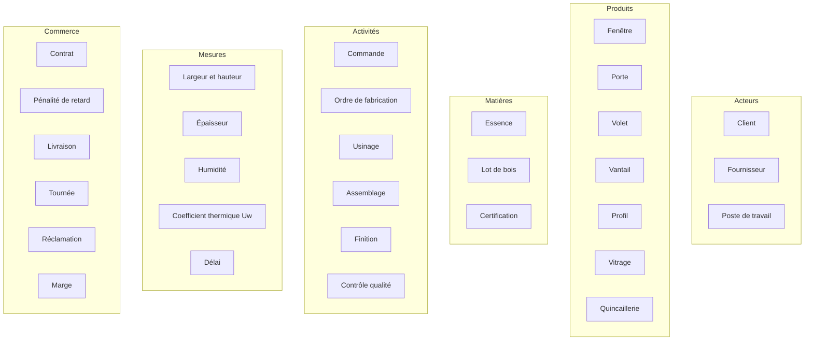
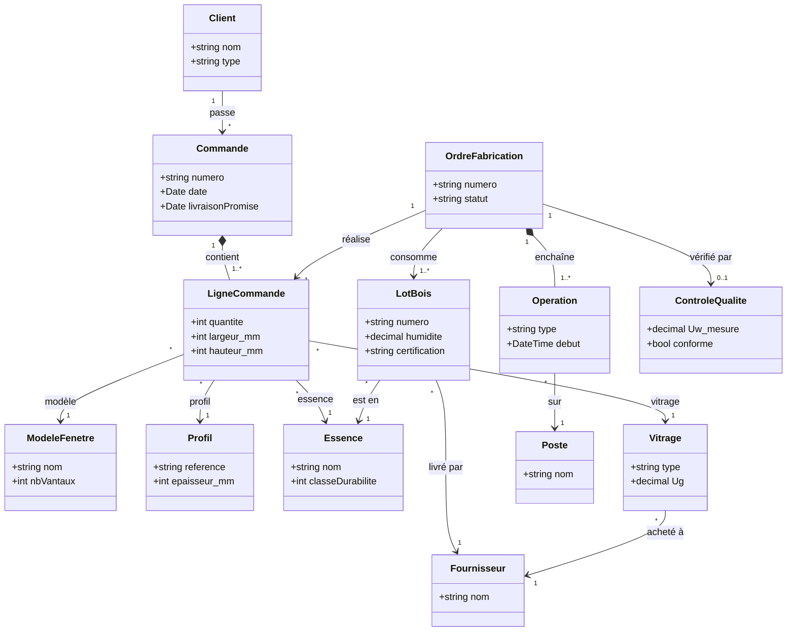
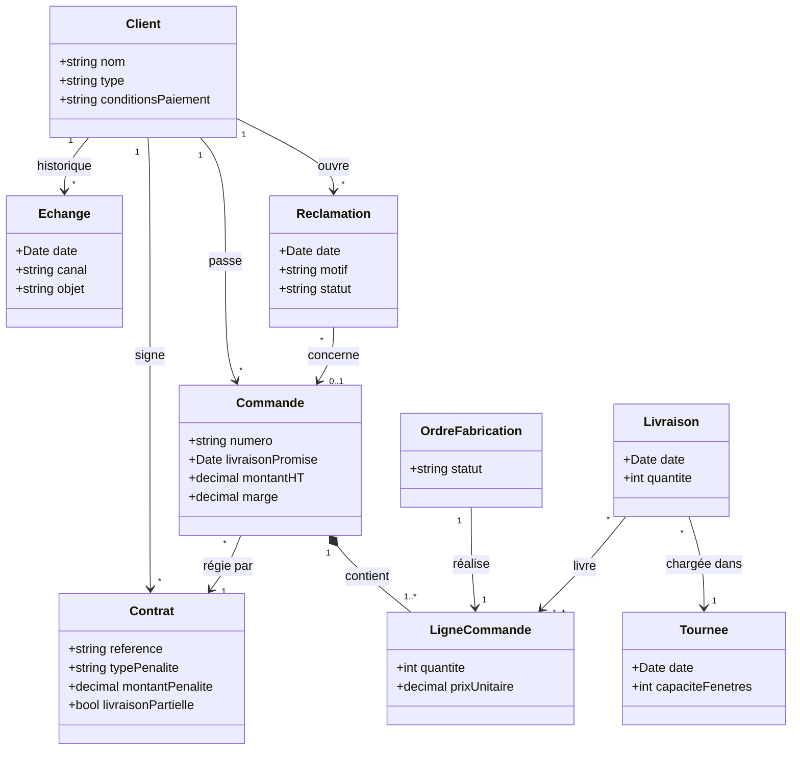
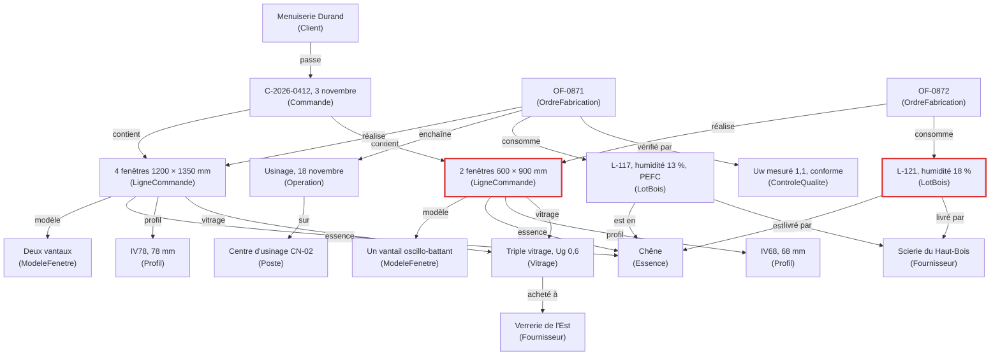

> 5.6 Les frontières de mon langage sont les frontières de mon monde.

Le livre de Ludwig Wittgenstein commence ainsi : "Ce livre ne sera peut-être compris que par qui aura déjà pensé lui-même les pensées qui s'y trouvent exprimées - ou du moins des pensées semblables. Ce n'est donc point un ouvrage d'enseignement. Son but serait atteint s'il se trouvait quelqu'un qui, l'ayant lu et compris, en retirait du plaisir". Je ne peux prétendre l'avoir compris au sens de Wittgenstein, cependant j'en retire des éléments qui m'aident à construire ma vision personnelle du monde.

Le Tractatus est organisé en propositions numérotées, qui sont certainement toutes importantes, je vous incite à les parcourir dans leur ensemble. Les sept nombres entiers portent les thèses principales, et les décimales viennent les commenter. Wittgenstein précise lui-même que les nombres indiquent le poids logique de chaque proposition. Ainsi 1.1 commente 1, et 1.12 commente 1.1. Pour donner une clé de lecture à qui voudrait ouvrir le livre, je reprends cette numérotation. Chaque partie porte le numéro des propositions qui m'ont le plus inspiré, et mes réflexions viennent à leur suite.

<!-- Les sept propositions principales (numéros et sens vérifiés sur le texte allemand, formulation française à aligner sur ton édition) :
1 Le monde est tout ce qui a lieu.
2 Ce qui a lieu, le fait, est la subsistance d'états de choses.
3 L'image logique des faits est la pensée.
4 La pensée est la proposition pourvue de sens.
5 La proposition est une fonction de vérité des propositions élémentaires.
6 La forme générale de la fonction de vérité est [p̄, ξ̄, N(ξ̄)].
7 Sur ce dont on ne peut parler, il faut garder le silence.
Option : les lister ici comme sommaire du livre. -->

## Avant-propos

> Tout ce qui proprement peut être dit peut être dit clairement, et sur ce dont on ne peut parler, il faut garder le silence.

Souvent, seule la deuxième partie a été retenue ; je préfère pour ma part le début, qui m'inspire et trouvera des développements dans la suite de cet article.

> Le livre tracera donc une frontière à l'acte de penser, - ou plutôt non pas à l'acte de penser, mais à l'expression des pensées.

> La frontière ne pourra donc être tracée que dans la langue, et ce qui est au-delà de cette frontière sera simplement dépourvu de sens.

On retrouve dans ma compréhension un concept analogue au théorème d'incomplétude de Gödel, pour lequel il y a l'ensemble de ce qui est vrai et l'ensemble de ce qui est démontrable. Pour Wittgenstein il y aurait l'ensemble des pensées (P), et le sous-ensemble des pensées exprimables (PE ⊊ P, contenu dans les pensées sans lui être égal). On peut élargir la sémantique de pensée à concept et d'autres encore, qui peuvent alors trouver des applications pratiques. En effet, il est nécessaire de concevoir ce qui peut être transmis dès lors que le langage constitue une courroie de transmission de l'action et de l'information, c'est le cas dans les organisations et de plus en plus dans les systèmes avec l'intégration de traitement de langage naturel (NLP, ou plus abusivement appelé IA).

<!-- [À toi] Nuance possible sur Gödel : le Tractatus (1921) précède Gödel (1931), et Wittgenstein parle de sens plutôt que de vérité (ce qui ne peut être dit peut se montrer, 4.1212). -->

## 1 Le monde est tout ce qui a lieu

> 1 Le monde est tout ce qui a lieu.
>
> 1.1 Le monde est la totalité des faits, non des choses.
>
> 1.12 Car la totalité des faits détermine ce qui a lieu, et aussi tout ce qui n'a pas lieu.

Le livre s'ouvre sur une phrase qui paraît évidente. Ce qui me frappe est la distinction entre les faits et les choses. Une chose, c'est un bateau, une bouée, le vent. Un fait, c'est le bateau qui se trouve à trois milles de la bouée avec quinze nœuds de vent de nord-ouest. Les choses prises seules restent muettes sur l'état du monde. Il faut les mettre en relation pour obtenir quelque chose qu'on peut affirmer ou nier, quelque chose de vrai ou de faux.

C'est ce que fait un ingénieur quand il modélise un système. Modéliser revient à choisir les faits qui comptent. Dans mon article sur [la pensée systémique](/posts/systemthinking/), l'état d'un système est le minimum d'information qu'il faut connaître pour prédire son évolution. Pour [mon routeur de voilier](/posts/controlerobuste/), ce sont la position du bateau, l'heure et le vent. La couleur de la coque en est absente, et ce choix est déjà une décision de modélisation. Un modèle est une totalité de faits choisie, et le monde du modèle s'arrête là.

La seconde moitié de 1.12 est plus subtile. La totalité des faits détermine aussi ce qui n'a pas lieu. Si je sais que le bateau est à Saint-Malo, je sais du même coup qu'il est absent de Pointe-à-Pitre. Décrire un état, c'est exclure tous les autres. En modélisation, on retrouve cette idée dans l'espace d'état et dans les contraintes. Dans [l'optimisation linéaire appliquée à Dofus](/posts/PanoplieOptimale/), les contraintes dessinent l'ensemble des équipements possibles, et tout ce qui reste en dehors est simplement impossible. Un modèle dit autant par ce qu'il exclut que par ce qu'il affirme.

Cette lecture prépare la suite. Si le monde est fait de faits, et si les faits s'expriment par des propositions, alors ce qu'on peut dire du monde dépend de la langue dont on dispose pour former ces propositions.

## 2 Ce qui a lieu, le fait, est la subsistance d'états de choses

<!-- [À vérifier] Citations de la partie 2 traduites par moi depuis l'allemand. À aligner sur ton édition française. -->

> 2 Ce qui a lieu, le fait, est la subsistance d'états de choses.
>
> 2.01 L'état de choses est une connexion d'objets (entités, choses).
>
> 2.0141 La possibilité de son occurrence dans des états de choses est la forme de l'objet.
>
> 2.04 La totalité des états de choses subsistants est le monde.
>
> 2.05 La totalité des états de choses subsistants détermine aussi quels états de choses ne subsistent pas.

En philosophie, l'ontologie est l'étude de ce qui existe et de la façon dont c'est organisé. Les premières pages du Tractatus en proposent une, construite par couches. Tout en bas se trouvent les objets, simples, qui forment la substance du monde (2.02 et 2.021). Les objets se combinent en états de choses. Un état de choses qui a lieu est un fait, et la totalité des faits est le monde. Wittgenstein se garde de donner un exemple d'objet, et les commentateurs en discutent encore.

La proposition 2.0141 me semble la plus riche. La forme d'un objet est l'ensemble des états de choses dans lesquels il peut apparaître. Un bateau peut être au port ou en mer, une commande peut être passée auprès d'un fournisseur. Chaque objet porte en lui ses possibilités de combinaison, et l'ensemble de ces possibilités dessine tous les mondes concevables. Les faits disent ensuite lesquels de ces états de choses ont effectivement lieu. On retrouve 1.12 et 2.05. Le possible est fixé par la forme des objets, le réel par les faits.

> 2.1 Nous nous faisons des images des faits.
>
> 2.12 L'image est un modèle de la réalité.
>
> 4.22 La proposition élémentaire consiste en noms. Elle est une connexion, un enchaînement de noms.

Le langage a exactement la même architecture. Un nom désigne un objet, une proposition élémentaire enchaîne des noms comme un état de choses enchaîne des objets, et une proposition vraie correspond à un fait. La proposition est une image du fait, et Wittgenstein emploie lui-même le mot de modèle. Elle partage avec la réalité une forme logique (2.18), ce qui lui permet de la représenter.

| Langage | Monde |
|---|---|
| Nom | Objet |
| Proposition élémentaire | État de choses |
| Proposition vraie | Fait |
| Totalité des propositions vraies | Monde |

Russell a donné à cette doctrine le nom d'atomisme logique. Je lis donc le Tractatus comme une ontologie de la langue. La structure du monde y est déduite de ce dont le langage a besoin pour avoir un sens.

Reste à savoir si une image est juste. « Pour reconnaître si l'image est vraie ou fausse, nous devons la comparer avec la réalité » (2.223). Une image se confronte au réel, et cette confrontation reviendra plus loin sous la forme de la vérification.

## 3.324 Les confusions fondamentales

> 3.324 Ainsi naissent facilement les confusions fondamentales (dont la philosophie est pleine)
>
> 3.325 Pour éviter ces erreurs, il nous faut employer une langue symbolique qui les exclut, qui n'use pas du même signe pour des symboles différents, ni n'use, en apparence de la même manière, de signes qui dénotent de manières différentes. Une langue symbolique qui obéisse à la grammaire logique - à la syntaxe logique (l'idéographie de Frege et de Russell constitue une telle langue, qui pourtant n'est pas encore exempte de toute erreur.)

### Construire à partir d'éléments simples

Ici je pense d'abord au formalisme qui permet l'avancée dans les disciplines (qu'elles soient scientifiques comme la mathématique ou humaines comme la philosophie, ce que Wittgenstein critique dans ces propositions). Ce formalisme doit se baser, comme en logique sur un ensemble aussi réduit que possible d'éléments totalement entendables à partir desquels on va construire toute chose plus élevée et plus complexe. C'est une des difficultés majeures de l'apprenant dans ces disciplines que de ne pas avoir tous les éléments nécessaires à l'assemblage de concepts plus avancés, dont la connaissance ne repose que sur ce graphe de méthodes d'assemblage remontant aux éléments fondateurs. Un texte ne se suffisant pas à lui-même est à mon sens cryptographique et doit forcément intentionnellement refuser d'être compris par tous.

### L'ambiguïté plutôt que la richesse

Le problème ne réside pas dans la richesse des concepts mais dans l'ambiguïté de leurs formulations. Je me réfère à Shannon (développé dans un autre article), et à son entropie qui définit l'information contenue dans chaque mot. On peut penser cela en graphe également. Par exemple, un ketch est un voilier à deux mâts dont le mât le plus grand est situé à l'avant. Donc "ketch" contient une information plus riche que l'hyponyme "voilier", lui-même plus riche que "bateau". Si je ne prends pas la peine de définir "voilier" comme je l'ai fait pour "ketch", c'est que je fais l'hypothèse que ce terme est connu de tous contrairement à "ketch" (ce sont ces raccourcis faits à tort qui freinent la compréhension des travaux mathématiques ou philosophiques). Le terme d'entropie utilisé par Shannon est par ailleurs précisément ce que dénonce Wittgenstein, car identique au "signe" utilisé en physique pour une acception différente.

### Des langues symboliques pour la technique

Dans le champ technique, la précision du langage comme élément indispensable de la transmission d'information est une question fascinante. C'était d'ailleurs en partie la question qui intéressait Shannon, qu'on retrouve à un niveau très élémentaire dans la numérisation, avec la redondance et la robustesse au bruit (bruit au sens admis dans les théories du contrôle). L'enjeu est donc dans la définition d'un langage qui permet d'exprimer ce que l'on a besoin d'exprimer. C'est le cas de domaines lexicaux particuliers dans le langage naturel, mais les "Domain Specific Languages" remplissent également cet office dans le champ technique.

## 5.6 Les frontières de mon langage

> 5.6 Les frontières de mon langage sont les frontières de mon monde.

C'est la phrase du livre qui m'a le plus marqué, et celle que je relis le plus souvent. Wittgenstein parle du langage de chacun, de *mon* langage. Je la lis aussi à propos des langages qu'on construit, et des machines qui les parlent.

### Le monde d'un modèle de langage

Un modèle de langage, comme ceux qui font fonctionner les assistants d'IA, apprend à partir de textes. Son monde est littéralement borné par ce qui a été écrit. Ce qui a été vécu sans être raconté lui reste inaccessible. La proposition 5.6 s'applique à lui presque mot pour mot.

Elle vaut aussi dans l'autre sens. Quand j'utilise une IA pour comprendre un sujet ou modéliser un système, tout passe par ce que je sais lui demander. Une question floue donne une réponse floue, et un concept que je ne sais pas nommer reste hors de la conversation. On retrouve l'exemple du ketch. Celui qui connaît le mot obtient une réponse sur les ketchs, celui qui l'ignore obtient une réponse sur les voiliers. Le vocabulaire de l'utilisateur fixe la résolution du monde qu'il explore.

### Modéliser un process avec un langage dédié

Dans une organisation, un process est d'abord décrit en langue naturelle, dans des procédures, des fiches, des courriels. La langue naturelle peut tout dire, et c'est son défaut, elle peut aussi tout dire de travers. Un langage dédié (*Domain Specific Language*) fait le choix inverse. Il fixe un petit vocabulaire, celui du domaine, et une grammaire stricte. Un langage de description de workflow connaît des étapes, des conditions, des acteurs, et s'en tient là. Le format GRIB des fichiers météo est lui aussi une langue de ce genre, qui sait dire le vent, la pression et la pluie en chaque point d'une grille.

Le process modélisé ne peut contenir que ce que le langage dédié sait exprimer. C'est 5.6 appliquée à un monde qu'on construit soi-même. Cette limite est voulue. On retrouve la langue symbolique réclamée en 3.325, qui exclut les confusions parce que sa syntaxe empêche de les formuler.

### Vocabulaire, ontologie, instances

L'informatique a repris le mot d'ontologie. Tom Gruber la définit en 1993 comme la spécification explicite d'une conceptualisation. Concrètement, une ontologie décrit des classes (Commande, Fournisseur, Machine), leurs propriétés (une date, un montant) et leurs relations (une commande est passée auprès d'un fournisseur). Le W3C a standardisé des langages pour les écrire. OWL (*Web Ontology Language*) permet de déclarer des classes et des relations, et d'en déduire des conséquences logiques. SHACL (*Shapes Constraint Language*) décrit la forme que doivent avoir les données et vérifie qu'elles la respectent. Ces langages restent généralistes. Ils savent décrire n'importe quel domaine, à condition qu'on leur donne un vocabulaire.

Je vois là trois étages, qui reprennent ceux du Tractatus.

- Le **vocabulaire** d'un domaine, qu'on peut fixer dans un langage dédié. Il dit avec quels mots on parle, par exemple de l'industrie en général. C'est la frontière de 5.6, celle des noms et des objets.
- L'**ontologie**, qui assemble ces mots pour décrire une industrie précise, voire une entreprise précise. Elle dit quels états de choses sont possibles, quelle commande peut être liée à quel fournisseur, quelle machine fabrique quelle pièce. C'est la forme des objets de 2.0141.
- Les **instances**, qui sont les faits. La commande passée le 3 novembre à tel fournisseur pour telle quantité en est une. Elles disent ce qui a lieu.

Je développe un exemple complet, celui d'une menuiserie fictive, dans la dernière partie de l'article.

Des éditeurs construisent déjà des logiciels sur ce schéma. Palantir appelle ontologie la couche qui relie les données d'une entreprise à des objets métier, avec leurs propriétés, leurs liens et les actions qu'on peut effectuer sur eux. Les modèles de langage y raisonnent et agissent à travers cette ontologie, avec ses mots et avec eux seuls. C'est 5.6 au sens strict.

L'IA change le coût de chaque étage. Elle peut extraire un vocabulaire et une ontologie à partir de procédures écrites en langue naturelle, rattacher des données existantes aux bonnes classes, proposer des instances. Un travail qui demandait des mois d'entretiens et de modélisation devient une conversation, que l'on vérifie ensuite.

### Vérifier ce qui est dit

L'intérêt d'une frontière nette est qu'on peut contrôler ce qui se trouve à l'intérieur. Une phrase en langue naturelle se discute. Une expression dans un langage formel se vérifie. Un compilateur dit si elle est bien formée, un test dit si elle fait ce qu'on attend, et parfois une preuve garantit qu'elle le fera toujours.

C'est ici que les modèles de langage changent la donne. Ils parlent la langue naturelle de l'utilisateur et savent écrire dans des langages formels. On peut leur décrire un process en quelques phrases et obtenir sa traduction dans un langage dédié. La traduction peut être fausse, l'IA se trompe, mais l'erreur devient visible puisque le résultat se trouve désormais du côté vérifiable de la frontière. Le langage formel sert alors de filet. Plus il est restreint, plus la vérification est facile, et plus on peut faire confiance à ce que produit l'IA. J'y vois une réponse pratique au problème de 3.324. L'ambiguïté reste dans la conversation, et la rigueur est imposée par le langage d'arrivée.

L'ontologie pousse la vérification jusqu'aux énoncés sur l'entreprise elle-même. Une phrase comme « ce process livre toute commande en 48 heures » devient une contrainte qu'on peut écrire en SHACL et confronter aux instances. C'est 2.223 appliquée à une organisation, on compare l'image à la réalité. Le Cercle de Vienne avait tiré du Tractatus un critère de sens fondé sur la vérification. Karl Popper, viennois lui aussi, lui a opposé en 1934 la falsifiabilité. Une affirmation générale se vérifie difficilement, puisqu'il faudrait examiner toutes les commandes passées et à venir. Elle se réfute en revanche avec une seule commande livrée en retard. Une ontologie rend les affirmations d'une entreprise falsifiables, et chaque contre-exemple devient une information. Soit le process est à corriger, soit l'ontologie est à revoir.

### Les jeux de langage

Wittgenstein lui-même a fini par trouver le Tractatus trop rigide. Dans les *Recherches philosophiques*, publiées en 1953 après sa mort, il abandonne l'idée d'un langage qui serait l'image fixe du monde. La signification d'un mot devient son emploi dans le langage (§43). Les mots prennent leur sens dans des jeux de langage, des usages situés, comme donner un ordre, décrire un objet, raconter une blague ou passer une commande.

Les modèles de langage sont la mise en œuvre la plus spectaculaire de cette seconde philosophie. Ils apprennent le sens d'un mot à partir des contextes où il apparaît, ce que le linguiste John Firth résumait en 1957 par « on connaît un mot à la compagnie qu'il fréquente ». Un modèle de langage apprend des usages plutôt que des définitions.

Les deux Wittgenstein me semblent se rejoindre dans la pratique. Le modèle de langage apporte la souplesse des jeux de langage. Le langage dédié et l'ontologie fixent un jeu particulier, avec des mots dont l'usage est précis dans un contexte donné. Ce jeu reste vivant. Une entreprise change, ses produits, ses fournisseurs et ses règles aussi, et son ontologie doit suivre.

C'est pourquoi je verrais bien une ontologie gérée comme du code, dans Git. Chaque modification du vocabulaire ou des relations devient un commit, daté et expliqué. On peut comparer deux versions, savoir quand un mot a changé de sens et pourquoi, et revenir en arrière si un changement s'avère mauvais. La réversibilité compte beaucoup ici, parce qu'une ontologie qui agit sur le monde doit pouvoir être corrigée sans tout reconstruire. Le versionnage donne à l'entreprise une mémoire de sa propre langue. Faire évoluer cette langue pas à pas devient alors une façon de faire évoluer l'entreprise elle-même.

### Du dire au faire

Jusqu'ici le langage décrivait. Avec les agents d'IA, il commence à agir. Une phrase adressée à un assistant peut devenir une requête dans une base de données, un courriel envoyé, un process qui se déclenche. Le philosophe John Austin avait décrit en 1962, dans *Quand dire, c'est faire*, ces énoncés qui accomplissent une action par le seul fait d'être prononcés, comme « je vous déclare mariés ». Ils étaient des exceptions dans la langue. Ils deviennent la règle dès que le langage est branché sur un système qui l'exécute.

Les frontières du langage deviennent alors les frontières de l'action. Ce qu'un agent peut faire est borné par les outils qu'on lui donne, c'est-à-dire par le langage dans lequel il peut s'adresser au monde. Concevoir ce langage revient à décider de ce qui est faisable. La précision réclamée par l'avant-propos prend alors un sens très concret. Ce qui est dit de travers sera fait de travers.

## 6.421 L'éthique ne se laisse pas énoncer

> 6.421 Il est clair que l'éthique ne se laisse pas énoncer. L'éthique est transcendantale. (Éthique et esthétique sont une seule et même chose.)

Hors de la loi du système $$ f $$, il y a la consigne $$ r $$, l'endroit où l'on veut l'emmener. On peut décrire le monde, prouver son évolution, les conséquences des actions, mais jamais affirmer ce qui est souhaitable. Définir cette consigne c'est la morale, elle échappe à la vérité ou à la logique. Je développe cette idée dans [mon article sur la pensée systémique](/posts/systemthinking/).

<!-- [À toi] Piste pour développer : un système (ou une IA) peut décrire, prévoir, prouver et maintenant agir, mais le souhaitable reste à l'extérieur. C'est la fonction objectif qu'on lui donne. Lien avec le choix du regret dans l'article sur le contrôle robuste et avec le "but" chez Meadows. -->

<!-- ## 7 Garder le silence
[À toi] Conclusion. Retour à l'avant-propos et à la proposition 7. Tu préférais "dire clairement" à "garder le silence". Avec l'IA, ce qui est dit est de plus en plus fait, donc dire clairement devient une exigence pratique. Annonce éventuelle de l'article sur le Cercle de Vienne. -->

## Mise en pratique, l'ontologie d'une menuiserie

Pour rendre tout cela concret, et ouvrir vers la suite, je termine par un exemple. Prenons un fabricant fictif de fenêtres en bois que j'appellerai la Menuiserie des Trois Vantaux. Elle fabrique des fenêtres sur mesure en chêne et en mélèze, achète son bois à des scieries et ses vitrages à un verrier, et vend à des particuliers comme à des artisans poseurs.

### Le vocabulaire

Le premier étage rassemble les mots du métier de la menuiserie. Ils sont posés côte à côte, sans encore de grammaire qui les relie. Ce vocabulaire vaut pour toute la profession. Il couvre l'atelier comme le commerce, et contient des mots dont notre menuiserie n'aura pas l'usage, comme la porte ou le volet.



### L'ontologie de la production

Le deuxième étage choisit dans ce vocabulaire les mots utiles à la Menuiserie des Trois Vantaux et dit comment ils se combinent. Une commande contient des lignes, chaque ligne porte sur un modèle de fenêtre dans une essence, avec un profil et un vitrage. Un ordre de fabrication réalise une ligne, enchaîne des opérations sur des postes et consomme des lots de bois, dont on connaît le fournisseur et l'humidité. Les chiffres aux extrémités des liens disent combien d'objets peuvent être reliés. Une commande contient au moins une ligne, un lot provient d'un seul fournisseur.



Le schéma dit ce qui est possible. Il faut y ajouter des règles, qui disent ce qui est permis. Les miennes sont inventées pour l'exemple.

- Un lot de bois doit être séché entre 10 et 15 % d'humidité avant d'être usiné.
- Un triple vitrage, plus lourd et plus épais, exige un profil d'au moins 78 mm.
- Le lot consommé par un ordre de fabrication doit être dans l'essence de la ligne qu'il réalise.
- Une ligne de commande ne part en livraison qu'avec un contrôle qualité conforme.

En SHACL, la première règle s'écrit ainsi.

```turtle
ex:LotBoisShape
    a sh:NodeShape ;
    sh:targetClass ex:LotBois ;
    sh:property [
        sh:path ex:humidite ;
        sh:datatype xsd:decimal ;
        sh:minInclusive 10 ;
        sh:maxInclusive 15 ;
        sh:message "Le bois doit être séché entre 10 et 15 % avant usinage" ;
    ] ;
    sh:property [
        sh:path ex:livrePar ;
        sh:class ex:Fournisseur ;
        sh:minCount 1 ;
        sh:maxCount 1 ;
    ] .
```

### Le volet commercial

Une entreprise ne se résume pas à son atelier. La même ontologie peut accueillir la base contractuelle, le suivi des clients et la logistique des livraisons. Un contrat fixe la date promise, les pénalités de retard et la possibilité de livrer en plusieurs fois. Une livraison emporte des lignes de commande dans une tournée, dont le camion a une capacité limitée. Les échanges et les réclamations gardent la mémoire de la relation avec chaque client. Ce volet se branche sur le précédent par la commande et ses lignes.



Les règles de ce volet s'ajoutent à celles de l'atelier.

- Une commande régie par un contrat sans livraison partielle part au complet.
- Une tournée transporte au plus autant de fenêtres que son camion peut en charger.
- Chaque jour de retard sur la date promise déclenche les pénalités prévues au contrat.

### Les instances

Le troisième étage contient les faits. Le 3 novembre, la Menuiserie Durand, un artisan poseur, commande quatre fenêtres à deux vantaux et deux fenêtres à un vantail, toutes en chêne et en triple vitrage. Chaque donnée de l'entreprise devient un objet typé par une classe de l'ontologie, relié aux autres par des liens que l'ontologie autorise.



Dès que les instances passent dans l'ontologie, on peut les interroger et les confronter aux règles. La première ligne est conforme. La seconde associe un triple vitrage à un profil de 68 mm, et le lot L-121 affiche 18 % d'humidité. Le validateur signale les deux, entourés en rouge sur le schéma, avant même que la première pièce soit usinée. La seconde ligne ne pourra donc pas partir avant d'être reprise.

On peut aussi poser des questions qui demanderaient autrement des heures de recherche dans des tableurs. Quelles fenêtres livrées cette année contiennent du bois du lot L-117 ? Quels clients seraient touchés si la Scierie du Haut-Bois livrait en retard ? Les réponses suivent les liens du graphe.

Chaque contre-exemple appelle une décision. Soit les faits sont à corriger, on resèche le lot et on change le profil. Soit la règle est à revoir. Si l'atelier adopte un jour un profil de 68 mm renforcé capable de porter un triple vitrage, c'est l'ontologie qui doit changer, et l'entreprise avec elle.

### Arbitrer une livraison

Fin novembre, la Menuiserie des Trois Vantaux a une seule tournée prévue le vendredi 28, avec un camion qui porte six fenêtres. La suivante part le mardi 2 décembre. Trois commandes sont en concurrence.

| Commande | Client | Prêtes | Date promise | Contrat |
|---|---|---|---|---|
| C-2026-0398 | Hôtel du Port | 4 fenêtres | 28 novembre | 500 € forfaitaires dès le premier jour de retard, livraison complète exigée |
| C-2026-0412 | Menuiserie Durand | 4 fenêtres sur 6 | 28 novembre | 1 % du montant restant par jour de retard, livraison partielle autorisée |
| C-2026-0420 | M. et Mme Martin | 2 fenêtres | 5 décembre | Conditions générales, sans pénalité |

Les deux dernières fenêtres de Durand attendent un lot de chêne correctement séché. Elles seront en retard quel que soit le choix et coûteront les mêmes pénalités dans tous les cas, on peut donc les laisser de côté. Le suivi client ajoute une information, l'Hôtel du Port a une réclamation ouverte pour le retard d'une commande précédente.

Les grandes fenêtres de Durand valent 1 900 € pièce. Reporter l'une d'elles au mardi coûte 19 € par jour pendant quatre jours, soit 76 €. Comparons trois chargements possibles.

| Chargement du vendredi | Reporté au mardi | Coût du report |
|---|---|---|
| Durand 4, Martin 2 | Hôtel du Port | 500 €, et une réclamation qui s'aggrave |
| Hôtel 4, Martin 2 | Durand 4 | 4 × 76 = 304 € |
| Hôtel 4, Durand 2 | Durand 2, Martin 2 | 2 × 76 = 152 €, et Martin reste livré avant la date promise |

Le troisième chargement l'emporte. C'est aussi le moins intuitif, puisqu'il coupe une commande en deux plutôt que de servir chaque client en entier. À coût égal, une règle supplémentaire peut départager par la marge, ou par la trésorerie en servant d'abord le client qui paie à la livraison. Sur un vrai planning, avec des dizaines de commandes et plusieurs tournées, ce choix devient un petit programme linéaire en nombres entiers, du même type que celui de [mon article sur Dofus](/posts/PanoplieOptimale/).

> Cette décision a mobilisé en même temps quatre sources d'information. La production signalait un lot trop humide, les contrats fixaient les pénalités et autorisaient la livraison partielle, le suivi client remontait une réclamation, et la logistique imposait la capacité du camion. Dans beaucoup d'entreprises, ces informations vivent dans quatre logiciels et dans la tête de quatre personnes. L'ontologie les réunit dans une même langue, où les règles de chaque domaine se vérifient ensemble et réagissent les unes aux autres. Un lot trop humide à l'atelier modifie le chargement du camion du vendredi.
{: .prompt-tip }

Branchons enfin un modèle de langage sur cette ontologie. Le responsable logistique pourrait demander en français qui livrer vendredi, et obtenir le chargement accompagné de sa justification, chaque étape étant vérifiable dans l'ontologie. C'est la piste que j'aimerais explorer dans un prochain article.

<!-- [À toi] Garder ou non l'annonce d'un prochain article. -->
