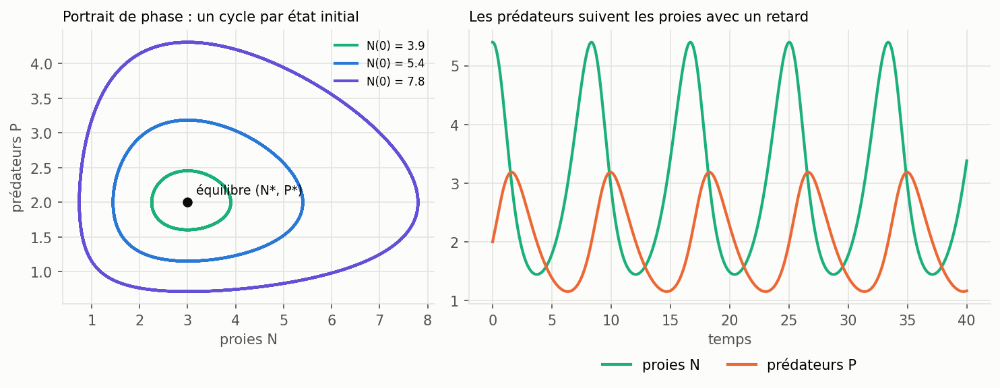
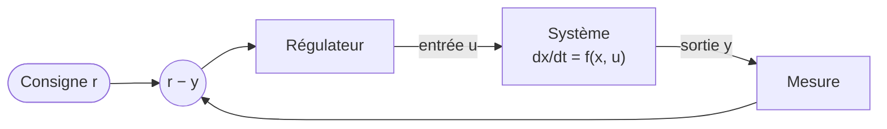

<!-- Notations de tout l'article : u entrée, x état, y sortie, w bruit, r consigne. Populations de Lotka-Volterra : N proies, P prédateurs. -->

Pendant la Première Guerre mondiale, les pêcheurs de l'Adriatique restent au port. Quand ils reprennent la mer, les biologistes constatent une chose étrange. Les requins et les raies représentent une part bien plus grande des prises qu'avant la guerre. Les espèces sont les mêmes, leurs comportements aussi. L'explication se trouve dans la structure du système, dans la façon dont proies et prédateurs se nourrissent les uns des autres.

Ce genre de phénomène est le sujet de *Thinking in Systems*, le livre de Donella Meadows. C'est aussi celui d'une branche des mathématiques que je pratique depuis longtemps, la théorie du contrôle et ses espaces d'état. Les deux parlent de la même chose avec des mots différents. Dans cet article, je présente le livre, puis je traduis son vocabulaire dans celui de l'automaticien, avec les proies et les prédateurs de l'Adriatique comme fil conducteur.

Je veux aussi défendre une thèse. Comprendre un système, c'est connaître la loi qui le fait évoluer. La science y travaille, et elle progresse. Piloter un système demande une chose de plus, savoir où l'on veut l'emmener. Cette deuxième question sort du domaine de la science, et c'est elle qui occupe de plus en plus de place à mesure que la première trouve ses réponses.

Cette façon de penser a beaucoup structuré la mienne. Je l'ai acquise pendant mes cours de théorie du contrôle et de systèmes à l'EPFL, et elle me sert depuis bien au-delà de l'automatique. Ses principes élémentaires, l'état, la rétroaction, le délai, la commandabilité et l'observabilité, relèvent des mathématiques appliquées. Je pense qu'ils devraient être bien plus largement partagés, et le livre de Meadows montre qu'on peut les transmettre presque sans équations. Je m'en sers ici comme d'un pont entre [mes notes sur le Tractatus](/posts/tractatus/), où je séparais ce que l'on peut décrire du monde et ce que l'on veut en faire, et mon [routeur de voilier](/posts/controlerobuste/), où la même séparation apparaît en équations.

## *Thinking in Systems* de Donella Meadows

Donella Meadows est l'une des auteurs du rapport au Club de Rome *The Limits to Growth*, publié en 1972. Le rapport reposait sur un modèle informatique du monde, World3, construit avec la méthode de la dynamique des systèmes développée par Jay Forrester au MIT. *Thinking in Systems* est un livre plus modeste et plus personnel. Meadows l'a écrit comme une introduction à cette façon de penser, et il a été publié en 2008, après sa mort, grâce à son éditrice Diana Wright.

Pour Meadows, un système est un ensemble d'éléments reliés entre eux et organisés de façon à produire quelque chose. Il a donc trois composantes, des éléments, des interconnexions et une fonction ou un but. Le but est la composante la moins visible et la plus déterminante. On peut changer tous les joueurs d'une équipe de football, elle reste une équipe de football. Si on lui demande de perdre, elle devient tout autre chose.

### Stocks et flux

L'image de base du livre est la baignoire. L'eau dans la baignoire est un **stock**. Le robinet et la bonde sont des **flux**, l'un entrant, l'autre sortant. Le stock change seulement par ses flux. Il garde la mémoire du passé, puisqu'il est la somme de tout ce qui est entré moins tout ce qui est sorti. Il amortit aussi les variations. On peut fermer le robinet d'un coup, la baignoire se vide lentement. Une population, un compte en banque, la quantité de CO₂ dans l'atmosphère et la confiance entre deux personnes sont des stocks.

### Les boucles de rétroaction

Les systèmes deviennent intéressants quand le niveau d'un stock agit sur ses propres flux. Meadows distingue deux boucles. La **boucle équilibrante** ramène un stock vers une cible, comme un thermostat qui allume le chauffage quand la pièce refroidit. La **boucle renforçante** amplifie l'écart, comme des intérêts composés ou une population qui fait d'autant plus d'enfants qu'elle est nombreuse. Elle produit des croissances, ou des effondrements, exponentiels.

### Les délais

Ajoutons un délai dans une boucle équilibrante et le système se met à osciller. Meadows prend l'exemple d'un concessionnaire automobile qui ajuste ses commandes à ses ventes. Les voitures commandées arrivent avec retard, il commande trop, puis trop peu, et son stock oscille alors que ses ventes sont stables (chapitre 2).

### Les pièges et les points de levier

Le livre décrit ensuite des pièges, des structures qui reviennent dans des systèmes très différents et produisent toujours les mêmes problèmes (chapitre 5). La tragédie des communs, l'escalade entre deux concurrents, le succès qui va aux plus forts, la dérive vers la médiocrité quand on baisse ses objectifs à chaque échec. Le piège que je rencontre le plus souvent est le transfert de charge. On traite le symptôme par une aide extérieure, le système perd sa capacité à se corriger seul, et il devient dépendant de l'aide.

La médecine en donne l'exemple le plus parlant. Une personne souffre du dos parce qu'elle reste assise toute la journée. La solution de fond serait de bouger davantage et de renforcer ses muscles, ce qui demande des semaines avant de soulager. Un antidouleur soulage tout de suite, alors elle y revient. Pendant ce temps, la cause reste en place, les muscles s'affaiblissent encore, et il faut des doses plus fortes pour le même effet. Le symptôme est traité, la capacité du corps à se corriger seul s'est réduite, et la dépendance à l'aide extérieure s'est installée. Meadows recommande de renforcer la capacité propre du système plutôt que de multiplier l'aide extérieure.

Le chapitre 6 classe les **points de levier**, les endroits où l'on peut intervenir sur un système, du moins efficace au plus efficace.

| Rang | Point de levier |
|---|---|
| 12 | Les paramètres et les constantes |
| 11 | La taille des tampons, les stocks qui amortissent |
| 10 | La structure des stocks et des flux |
| 9 | Les délais |
| 8 | Les boucles équilibrantes |
| 7 | Les boucles renforçantes |
| 6 | Les flux d'information |
| 5 | Les règles |
| 4 | La capacité du système à s'auto-organiser |
| 3 | Les buts du système |
| 2 | Le paradigme dont le système est issu |
| 1 | La capacité à dépasser les paradigmes |

Le classement me frappe à chaque lecture. Les paramètres, là où l'on agit le plus souvent, sont le levier le plus faible. Changer un taux d'imposition ou une subvention déplace rarement le comportement d'ensemble. Les buts, eux, sont tout en haut de la liste. Je reviendrai sur ce point à la fin de l'article.

## Un système livré à lui-même

### L'espace d'état

L'automaticien décrit un système par son **état**. L'état est le minimum d'information sur le passé qu'il faut connaître pour prédire l'avenir. Dans le vocabulaire de Meadows, l'état, ce sont les stocks. On le rassemble dans un vecteur $$ x $$, et l'évolution du système s'écrit

$$ \dot{x} = f(x) $$

Le point au-dessus du $$ x $$ désigne sa variation dans le temps. L'équation dit que la façon dont l'état change dépend seulement de l'état lui-même. La fonction $$ f $$ contient toute la structure du système, ses flux et ses boucles. Pour un système livré à lui-même, tout l'avenir est donc contenu dans l'état initial $$ x(0) $$. Connaître $$ f $$ et $$ x(0) $$ suffit pour dérouler la suite.

La baignoire est le plus simple des systèmes. Son état est le volume d'eau $$ x $$. Si la bonde évacue d'autant plus d'eau que la baignoire est pleine, avec un coefficient $$ k $$, on obtient

$$ \dot{x} = -k\,x $$

dont la solution $$ x(t) = x(0)\,e^{-kt} $$ décrit une baignoire qui se vide de moins en moins vite.

Quand le système est linéaire, $$ f $$ devient une matrice $$ A $$ et l'équation s'écrit $$ \dot{x} = Ax $$. Le comportement est alors entièrement lisible dans les valeurs propres de $$ A $$. Une valeur propre de partie réelle positive signale une boucle renforçante qui domine, et le système explose. Une partie réelle négative signale une boucle équilibrante, et le système revient à l'équilibre. Une partie imaginaire non nulle signale une oscillation, la signature d'une boucle équilibrante avec délai. Les intuitions de Meadows deviennent des nombres qu'on peut calculer.

### Le modèle de Lotka-Volterra

Revenons à l'Adriatique. Le biologiste Umberto D'Ancona étudie les statistiques des marchés aux poissons de Trieste, Fiume et Venise. Il constate que la proportion de sélaciens (requins et raies) dans les prises a nettement augmenté pendant la guerre, quand la pêche était réduite. En 1925, il soumet la question à son beau-père, le mathématicien Vito Volterra. Celui-ci publie l'année suivante un modèle à deux espèces, que le chimiste et démographe Alfred Lotka avait obtenu de son côté en 1925.

Notons $$ N $$ la population de proies et $$ P $$ celle des prédateurs. L'état du système est le couple $$ x = (N, P) $$, et son évolution s'écrit

$$ \dot{N} = \alpha N - \beta N P, \qquad \dot{P} = \delta N P - \gamma P $$

Chaque terme se lit comme un flux de Meadows. Les proies se reproduisent au taux $$ \alpha $$, c'est une boucle renforçante. Elles sont mangées d'autant plus souvent que les rencontres avec les prédateurs sont fréquentes, d'où le terme $$ \beta NP $$. Les prédateurs se nourrissent de ces rencontres et se reproduisent grâce à elles, avec le terme $$ \delta NP $$, et meurent au taux $$ \gamma $$. Le croisement des deux crée une boucle équilibrante entre les deux stocks, et le temps que mettent les prédateurs à se reproduire joue le rôle du délai.

Le système a un équilibre où les deux populations restent constantes.

$$ N^\star = \frac{\gamma}{\delta}, \qquad P^\star = \frac{\alpha}{\beta} $$

Autour de cet équilibre, on peut approcher le système par un système linéaire. Sa matrice a deux valeurs propres imaginaires pures, $$ \pm i\sqrt{\alpha\gamma} $$. Une partie réelle nulle et une partie imaginaire non nulle, le système oscille sans s'amortir ni exploser. Les proies prolifèrent, les prédateurs suivent, les proies s'effondrent, les prédateurs meurent de faim, et le cycle recommence.

Le modèle a une propriété remarquable. La quantité

$$ V(N, P) = \delta N - \gamma \ln N + \beta P - \alpha \ln P $$

reste constante au cours du temps. Chaque état initial dessine donc son propre cycle fermé, et le système y tourne indéfiniment. On voit ici très concrètement que l'avenir est contenu dans l'état initial. Deux mers qui partent de populations différentes suivent deux cycles différents pour toujours.

_À gauche, trois états initiaux donnent trois cycles fermés autour de l'équilibre. À droite, l'évolution dans le temps pour l'un d'eux. Le pic des prédateurs suit celui des proies avec un retard. Paramètres $$ \alpha = 1 $$, $$ \beta = 0{,}5 $$, $$ \gamma = 0{,}6 $$, $$ \delta = 0{,}2 $$._

Ce modèle est fragile. Une petite modification, par exemple une limite à la croissance des proies quand la nourriture manque, transforme les cycles fermés en spirales qui convergent vers l'équilibre. Meadows répète que tout ce que nous savons du monde est un modèle. Lotka-Volterra en est une bonne illustration, il est faux dans le détail et juste dans ce qu'il enseigne.

## Agir et observer

### L'entrée, la sortie et le bruit

Un système livré à lui-même se contente de dérouler son état initial. Pour agir dessus, l'automaticien ajoute une **entrée** $$ u $$, ce sur quoi on a la main. Pour le connaître, il ajoute une **sortie** $$ y $$, ce qu'on peut mesurer. La forme générale devient

$$ \dot{x} = f(x, u), \qquad y = h(x) + w $$

Le terme $$ w $$ représente le **bruit**, toutes les imperfections de la mesure. On mesure toujours le système à travers un instrument imparfait. Je laisse le bruit de côté dans la suite, et j'y reviendrai dans [l'article sur le contrôle robuste](/posts/controlerobuste/).

En vocabulaire Meadows, l'entrée est un flux qu'on pilote, et la sortie est un flux d'information. Ce dernier est le sixième point de levier, et l'automatique dit pourquoi il compte autant. On corrige seulement ce qu'on mesure.

### Le principe de Volterra

Dans l'Adriatique, l'entrée est l'effort de pêche $$ u $$. Une pêche qui prélève indistinctement proies et prédateurs retire à chacun une part proportionnelle à sa population.

$$ \dot{N} = (\alpha - u)N - \beta N P, \qquad \dot{P} = \delta N P - (\gamma + u)P $$

L'équilibre se déplace.

$$ N^\star = \frac{\gamma + u}{\delta}, \qquad P^\star = \frac{\alpha - u}{\beta} $$

Quand on pêche moins, $$ u $$ diminue, l'équilibre des proies baisse et celui des prédateurs monte. C'est exactement ce qu'a observé D'Ancona. La guerre a réduit la pêche, et les requins en ont profité plus que les sardines. L'effet est contre-intuitif. On s'attendrait à ce que l'arrêt de la pêche profite à tout le monde. Il profite surtout aux prédateurs, à cause de la structure des boucles. C'est le même mécanisme qui fait qu'un insecticide tue aussi les prédateurs naturels des ravageurs et peut finir par favoriser les ravageurs.

La sortie mérite qu'on s'y arrête. D'Ancona ignorait tout des populations réelles de poissons de l'Adriatique. Il disposait seulement des registres des marchés, c'est-à-dire la proportion de sélaciens dans les prises.

$$ y = \frac{P}{N + P} $$

Tout le travail de Volterra a consisté à remonter de cette sortie vers l'état caché du système. C'est la question de l'**observabilité**.

### Commandabilité et observabilité

Rudolf Kalman a posé, vers 1960, deux questions qui structurent toute l'automatique. La première est la **commandabilité**. Avec les entrées dont je dispose, puis-je amener le système dans n'importe quel état ? Pour un système linéaire $$ \dot{x} = Ax + Bu $$, la réponse se lit dans le rang d'une matrice.

$$ \operatorname{rang}\begin{bmatrix} B & AB & \cdots & A^{n-1}B \end{bmatrix} = n $$

Pour la pêche, autour de l'équilibre, $$ B $$ vaut $$ (-N^\star, -P^\star) $$ puisque l'effort de pêche retire à chaque population une part proportionnelle à son niveau. Le calcul donne une matrice de rang 2[^commandabilite]. Avec le seul effort de pêche, on peut donc déplacer localement les deux populations où l'on veut.

La seconde question est l'**observabilité**. À partir des mesures dont je dispose, puis-je reconstruire l'état ? Pour $$ y = Cx $$, elle se lit dans un critère symétrique.

$$ \operatorname{rang}\begin{bmatrix} C \\ CA \\ \vdots \\ CA^{n-1} \end{bmatrix} = n $$

Ces deux critères donnent une traduction précise à des idées de Meadows. Un stock non observable est un stock dont l'information ne remonte jamais jusqu'au décideur. Un stock non commandable est hors de portée de tous les leviers dont on dispose. Beaucoup de politiques échouent pour l'une de ces deux raisons, bien avant que se pose la question du réglage.

### La boucle fermée

Jusqu'ici l'effort de pêche était fixé à l'avance. On parle de boucle ouverte. En **boucle fermée**, on calcule l'entrée à partir de la sortie mesurée. On compare la sortie à une **consigne** $$ r $$, la valeur qu'on souhaite lui voir prendre, et on agit sur l'écart $$ r - y $$.

Un régulateur des pêches pourrait ainsi augmenter l'effort quand la proportion de requins dépasse la consigne, et le réduire quand elle passe en dessous. La boucle fermée est une boucle équilibrante qu'on ajoute volontairement au système. Les délais de Meadows y gardent tout leur danger. Une correction trop forte sur un système lent le fait osciller, comme le concessionnaire et ses voitures.

Le pilote automatique d'un voilier est l'exemple que j'ai le plus souvent sous les yeux. La consigne $$ r $$ est un cap, ou un angle par rapport au vent. La sortie $$ y $$ est le cap mesuré par le compas, ou l'angle mesuré par la girouette. L'entrée $$ u $$ est l'angle de barre. À chaque instant, le pilote mesure l'écart et tourne la barre pour le réduire. Réglé trop mou, il laisse le bateau dériver de sa route. Réglé trop dur, il corrige trop fort, dépasse le cap, corrige dans l'autre sens, et le bateau se met à zigzaguer. C'est l'oscillation du concessionnaire, avec un délai qui tient à l'inertie du bateau et au temps que met la houle à le faire tourner. Les pilotes de course mesurent aussi la vitesse de rotation du bateau pour anticiper ses mouvements, ce qui revient à réduire le délai de la boucle.

## La consigne, ou ce que la science ne dit pas

### Deux questions séparées

Le schéma de la boucle fermée sépare deux choses que l'on confond souvent. D'un côté, il y a la loi du système $$ f $$, la façon dont l'état évolue et répond à nos actions. De l'autre, il y a la consigne $$ r $$, l'endroit où l'on veut l'emmener. La première est une question de connaissance. La seconde est une question de volonté.

Le modèle de Volterra dit précisément ce qui arrive aux sardines et aux requins pour chaque effort de pêche. Il reste muet sur la proportion de requins que nous devrions souhaiter. Faut-il maximiser les prises des pêcheurs d'aujourd'hui, préserver les stocks pour ceux de demain, protéger les requins pour eux-mêmes ? Le modèle éclaire chacun de ces choix, sans en trancher aucun.

### La connaissance converge

Je suis frappé par la façon dont la science réduit l'incertitude sur $$ f $$. Le climat en donne un bon exemple. Le GIEC établit dans son sixième rapport que le réchauffement est à peu près proportionnel au CO₂ émis depuis le début de l'ère industrielle. Chaque millier de milliards de tonnes de CO₂ ajoute environ 0,45 °C, avec une fourchette probable de 0,27 à 0,63 °C. On connaît donc, avec une marge d'erreur, la conséquence de nos émissions sur l'état du système.

Il faut rester honnête sur les limites de cette convergence. Même avec une loi parfaite, un système chaotique comme l'atmosphère reste imprévisible au-delà d'un certain horizon. Les mesures portent toujours un bruit. Et dans les systèmes humains, le modèle change quand les gens le connaissent et adaptent leur comportement. Meadows elle-même invite à l'humilité. Pour elle, on apprend à danser avec les systèmes plutôt qu'à les contrôler (chapitre 7). Ma thèse est donc plus modeste qu'elle n'en a l'air. La connaissance de $$ f $$ progresse, et ce qui reste incertain se mesure de mieux en mieux.

### La consigne reste à choisir

Quand l'incertitude sur $$ f $$ recule, la question de $$ r $$ occupe toute la place. L'ADEME a publié en 2021 quatre scénarios pour atteindre la neutralité carbone en France en 2050. Ils vont d'une société de sobriété à un pari sur les technologies de captage du carbone. Les quatre reposent sur la même connaissance du système, et ils décrivent quatre sociétés très différentes. Choisir entre eux est un choix politique. Combien d'efforts demander à la génération actuelle pour les suivantes, comment répartir ces efforts entre les pays riches et les autres, entre les plus aisés et les plus modestes, quelle place laisser au reste du vivant. Toutes ces questions portent sur la consigne.

Le philosophe David Hume avait formulé cette séparation en 1740, dans le troisième livre de son *Traité de la nature humaine*. On ne peut pas déduire ce qui doit être de ce qui est. Une description du monde, aussi complète soit-elle, ne contient aucune obligation. On parle depuis de la guillotine de Hume.

Max Weber en a tiré les conséquences pour le rapport entre science et politique. Dans *Le Savant et le Politique*, qui réunit deux conférences de 1917 et 1919, il assigne à la science un rôle précis. Elle peut dire quels moyens conviennent à une fin donnée, quelles conséquences entraîne chaque choix, et ce qu'il coûte. Le choix de la fin lui échappe. Weber parle d'une guerre des dieux pour désigner le conflit des valeurs entre lesquelles chacun doit trancher. Le scientifique qui prétend choisir la consigne au nom de la science sort de son rôle. Le politique qui conteste la loi $$ f $$ pour éviter de débattre de la consigne sort du sien.

C'est là que je vois le vrai débat politique. Les faits établis par le GIEC devraient faire converger tout le monde sur la loi du système, et le désaccord légitime porte sur la consigne. Une démocratie en bonne santé discute de $$ r $$ en partageant $$ f $$.

### Ce que je veux faire de ma vie

La même séparation vaut à l'échelle d'une vie. Je connais de mieux en mieux les conséquences de mes actes, sur ma santé, mon travail, mes proches. Cette connaissance laisse entière la question de ce que je veux en faire. Albert Camus ouvre *Le Mythe de Sisyphe* en 1942 sur cette question, la seule qu'il juge vraiment sérieuse, celle de savoir si la vie vaut la peine d'être vécue. Pour lui, l'absurde naît de la confrontation entre l'appel humain et le silence déraisonnable du monde. Le monde décrit par la science a sa loi $$ f $$, et il garde le silence sur $$ r $$. Camus conclut qu'il faut imaginer Sisyphe heureux. Sisyphe sait exactement ce qui arrivera à son rocher. Il lui reste à décider ce que signifie pour lui de le pousser.

### Retour à Wittgenstein et à Meadows

Dans [mon article sur le Tractatus](/posts/tractatus/), je citais la proposition 6.421. Il est clair que l'éthique ne se laisse pas énoncer. Le langage des propositions décrit les faits, il dit ce qui a lieu. La consigne se tient hors de ce langage. On peut écrire $$ f $$ avec une précision croissante, et la valeur de $$ r $$ restera toujours une décision.

Meadows retrouve la même idée par un autre chemin. Dans son classement des points de levier, les buts du système arrivent en troisième position, juste après les paradigmes. Changer la consigne d'un système est l'une des interventions les plus puissantes qui soient, bien plus puissante que le réglage de n'importe quel paramètre. Le levier le plus fort est aussi celui que la science nous laisse.

## Conclusion

Meadows fournit une grammaire pour regarder les systèmes, avec ses stocks, ses boucles, ses délais et ses buts. L'espace d'état fournit le calcul, avec les valeurs propres, la commandabilité et l'observabilité. Le modèle de Lotka-Volterra montre les deux à l'œuvre, d'abord comme système libre qui déroule son état initial, puis comme système qu'on pilote et qu'on observe. La science réduit l'incertitude sur la loi du système, et plus elle avance, plus il nous revient de choisir la consigne. Dans [l'article suivant](/posts/controlerobuste/), je regarde ce qui se passe quand la loi du système reste incertaine, et comment le choix de ce qu'on minimise fait partie de la décision.

## Références

- Meadows, D. H. (2008). *Thinking in Systems: A Primer*. Chelsea Green. (Trad. fr. *Pour une pensée systémique*, Rue de l'échiquier, 2022.)
- Meadows, D. H. (1999). *Leverage Points: Places to Intervene in a System*. Sustainability Institute.
- Meadows, D. H., Meadows, D. L., Randers, J., Behrens, W. W. (1972). *The Limits to Growth*. Universe Books.
- Lotka, A. J. (1925). *Elements of Physical Biology*. Williams & Wilkins.
- Volterra, V. (1926). « Variazioni e fluttuazioni del numero d'individui in specie animali conviventi ». *Memorie della R. Accademia Nazionale dei Lincei*, série VI, vol. 2, 31-113.
- Kalman, R. E. (1960). « On the general theory of control systems ». *Proceedings of the First IFAC Congress*, Moscou.
- Åström, K. J., Murray, R. M. (2008). *Feedback Systems: An Introduction for Scientists and Engineers*. Princeton (gratuit en ligne).
- GIEC (2021). *Climate Change 2021: The Physical Science Basis*, résumé pour les décideurs, section D.1.
- ADEME (2021). *Transition(s) 2050. Choisir maintenant, agir pour le climat*.
- Hume, D. (1739-1740). *Traité de la nature humaine*, livre III (1740), partie I, section I.
- Weber, M. (1919). *Le Savant et le Politique*.
- Camus, A. (1942). *Le Mythe de Sisyphe*. Gallimard.

[^commandabilite]: Autour de l'équilibre, $$ A = \begin{bmatrix} 0 & -\beta N^\star \\ \delta P^\star & 0 \end{bmatrix} $$ et $$ B = (-N^\star, -P^\star) $$. On obtient $$ AB = (\beta N^\star P^\star, -\delta N^\star P^\star) $$, puis $$ \det\begin{bmatrix} B & AB \end{bmatrix} = N^\star P^\star (\delta N^\star + \beta P^\star) > 0 $$.
