J'aime beaucoup la voile, et ce mois de novembre se courait la Route du Rhum, la transatlantique en solitaire entre Saint-Malo et Pointe-à-Pitre. En suivant la flotte sur la cartographie, je me suis demandé comment les skippers choisissaient leur route. Faut-il passer au nord d'une dépression ou plonger au sud chercher les alizés ? Sur cette édition, les multicoques (Ultim, Ocean Fifty et Vintage Multi) ont le droit d'être conseillés par une équipe à terre. Les skippers des monocoques IMOCA et Class40 décident seuls, avec les fichiers météo et le logiciel de routage qu'ils ont à bord.

J'ai voulu comprendre ce que fait ce logiciel, alors j'en ai écrit un petit. Une question plus intéressante est vite apparue. Un routeur sait calculer la route la plus rapide pour une météo donnée. Or la météo de demain reste incertaine, et les centres de prévision fournissent plusieurs scénarios. Choisir une route devient alors un problème de décision sous incertitude, celui que traite le **contrôle robuste**. Je pars ici des données d'entrée d'un routeur, puis je présente la méthode des isochrones et ses liens avec la programmation dynamique et l'optimisation linéaire, avant d'arriver au contrôle robuste et à la notion de regret.

Le projet est écrit en Python. Un Raspberry Pi a tourné seul pendant toute la course. Toutes les six heures, à chaque nouveau run du modèle américain, il archivait les positions de la flotte relevées sur la cartographie officielle et les fichiers météo, routait les bateaux depuis leur position réelle, puis recalculait un faisceau de routes d'ensemble et une décision robuste. Tout est archivé avec les données d'entrée, ce qui permet de rejouer chaque calcul après coup. Je me suis concentré sur les Class40, la classe la plus nombreuse avec 49 bateaux au départ, et j'ai fait courir parmi eux un Class40 virtuel qui suivait les conseils de mon routeur. Les figures de cet article sortent de ces archives.

## Les données d'entrée

Un routeur a besoin de deux choses. Il doit savoir ce dont le bateau est capable, et ce que le vent va faire.

### Les polaires

Chaque bateau a sa signature, ses **polaires**. Ce sont des tableaux qui donnent la vitesse du bateau selon deux grandeurs, la force du vent réel (TWS pour *true wind speed*) et l'angle entre le cap du bateau et la direction d'où vient le vent (TWA pour *true wind angle*).

$$ V = V(\text{TWS}, \text{TWA}) $$

On les trace en coordonnées polaires, d'où leur nom. Pour chaque force de vent on obtient une courbe, et la distance au centre donne la vitesse dans chaque direction. On y lit ce que tout marin sent à la barre. Face au vent le bateau s'arrête, il atteint sa vitesse maximale au travers ou au largue, et au vent arrière il va souvent plus vite en tirant des bords qu'en filant droit. Les architectes calculent les polaires avec des logiciels de prédiction de vitesse (VPP pour *velocity prediction program*), puis les équipes les corrigent avec les mesures faites en navigation. Le routeur lit ce tableau et interpole entre les valeurs.

Les polaires des équipes restent secrètes. J'ai utilisé les seules polaires publiques, celles des certificats de jauge ORC, calculées par un VPP. Pour les Class40, j'en ai tiré deux versions, la médiane de 31 certificats de la classe et celle d'un scow récent, un Mach 2 de 2022, que j'ai utilisée dans la suite. Ces polaires sont plutôt prudentes. À chaque cycle, j'ai comparé la distance parcourue par les vrais Class40 dans les 24 heures suivantes à celle que prévoyait mon routeur. En médiane sur la course, ils allaient 6 % plus vite que prévu, et la moitié des cycles se situent entre 1 % moins vite et 19 % plus vite. Une partie de l'écart vient de la polaire, une autre du vent, que le modèle ne prévoit jamais parfaitement.

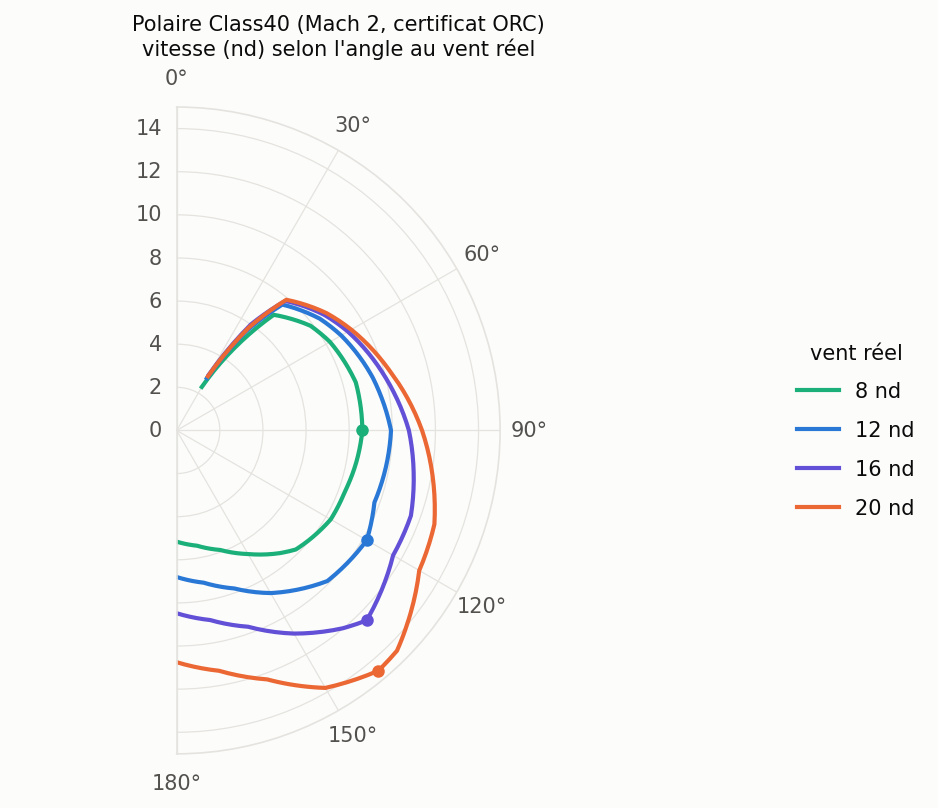
_Polaire du Class40 Mach 2 (certificat ORC). Le point marque la vitesse maximale pour chaque force de vent. Plus le vent forcit, plus l'angle le plus rapide s'écarte vers le largue._

### Les fichiers météo

La météo arrive sous forme de fichiers GRIB. Ce sont des grilles qui donnent, en chaque point et à chaque pas de temps, la vitesse et la direction du vent prévues. Les grands centres de prévision les produisent à partir de leurs modèles numériques de l'atmosphère. Aux États-Unis, la NOAA publie gratuitement le modèle **GFS**, le plus utilisé par les plaisanciers. En Europe, le centre européen ECMWF fait tourner le modèle **IFS**, réputé le plus fiable à moyen terme. Météo-France produit **ARPEGE** à l'échelle du globe et **AROME** en haute résolution sur la France. Enfin des fournisseurs commerciaux retravaillent ces données ou font tourner leurs propres modèles.

Le problème est que l'atmosphère est un système chaotique. Edward Lorenz l'a montré en 1963 sur un modèle très simplifié de convection. Deux états initiaux presque identiques finissent par donner des évolutions complètement différentes. Les mesures de l'état actuel de l'atmosphère contiennent toujours des erreurs, et ces erreurs grossissent avec le temps. Au-delà de quelques jours, une prévision unique donne une fausse impression de certitude.

Les centres de prévision ont trouvé une parade, la **prévision d'ensemble**. Ils font tourner le même modèle plusieurs fois, en perturbant légèrement les conditions initiales. Chaque calcul s'appelle un membre et donne un scénario plausible. L'ensemble américain GEFS compte 31 membres (un contrôle et trente perturbés), l'ensemble européen ENS en compte 51. Quand les membres restent groupés, la prévision est fiable. Quand ils divergent, l'atmosphère hésite entre plusieurs évolutions, et le marin aussi.

J'ai utilisé l'ensemble GEFS, gratuit et publié toutes les six heures, sur une grille de 0,5° couvrant l'Atlantique de 5° à 55° N. Les échéances sont espacées de 6 h jusqu'à dix jours, puis de 12 h jusqu'à seize jours. La route déterministe utilise GFS à 0,25°, et le modèle européen IFS sert de second avis.

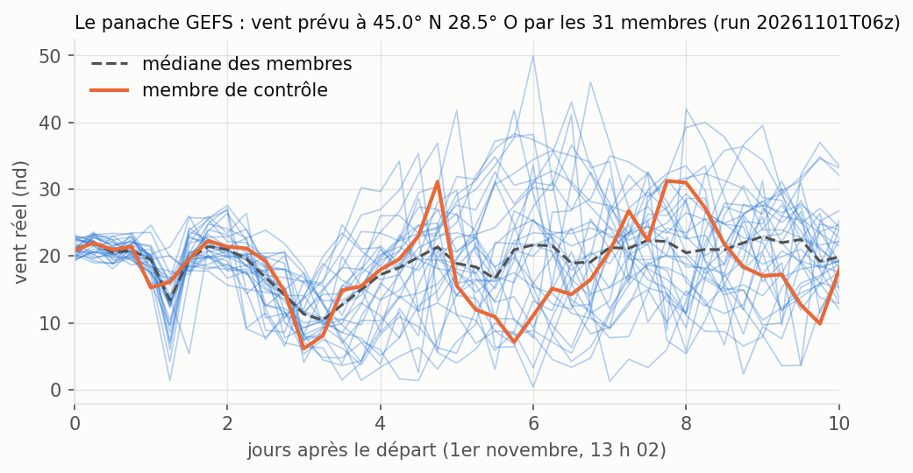
_Le vent prévu par les 31 membres en un point situé au milieu de l'Atlantique nord, sur le chemin de la flotte, pour le run du matin du départ. Les membres restent groupés pendant deux jours. L'écart type passe de 2 nœuds à J+1 à 4 nœuds à J+3, puis à près de 9 nœuds à J+7, autant dire qu'à cette échéance la prévision ne dit plus grand-chose en ce point._

Une carte rend la divergence plus concrète. Voici trois membres du même run, quatre jours après le départ.

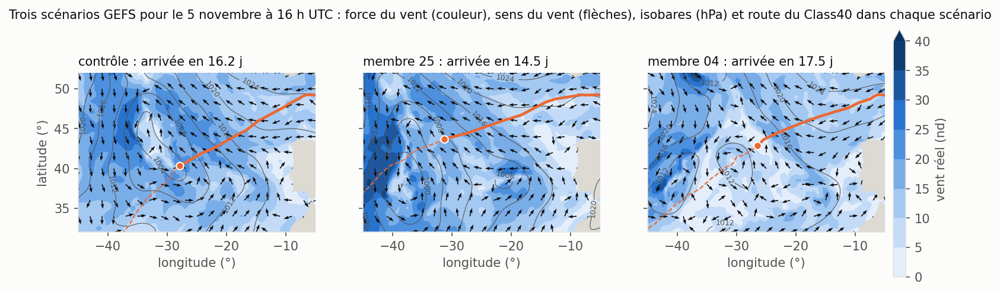
_Le vent prévu le 5 novembre à 16 h UTC par trois membres GEFS partis du même état initial. La couleur donne la force du vent, les flèches le sens dans lequel il souffle, et les lignes fines les isobares. En orange, la route optimale du Class40 dans chaque scénario, en trait plein jusqu'à cette date. J'ai retenu le membre de contrôle et les deux scénarios qui reviennent plus loin dans l'analyse de la décision. Dans le contrôle, le bateau se trouve vers 40° N 28° O, au contact d'une dépression creusée sur le chemin de la flotte. Dans le membre 25, il a déjà atteint 31° O, plus au nord, et arrive en 14,5 jours. Dans le membre 04, il reste bloqué plus à l'est dans des vents faibles et met 17,5 jours. Trois scénarios plausibles, trois jours d'écart à l'arrivée._

## Calculer la meilleure route pour une météo donnée

Commençons par le cas simple où l'on connaît la météo. On cherche la suite de caps qui amène le bateau le plus vite possible à l'arrivée, sachant que le vent change selon le lieu et l'heure. Le mathématicien Ernst Zermelo a posé ce problème dès 1931, pour un navire pris dans un vent variable. Dans le langage de mon article sur [la pensée systémique](/posts/systemthinking/), c'est un système en espace d'état. L'état est la position du bateau, la commande est le cap.

### La méthode des isochrones

La méthode la plus répandue dans les logiciels de routage, et celle que j'ai programmée, est celle des **isochrones**. Proposée par R. W. James en 1957 pour la marine américaine, elle a été adaptée au calcul sur ordinateur par Hagiwara en 1989. Son principe est intuitif. Depuis le point de départ, on essaie tous les caps possibles, par exemple tous les cinq degrés. Pour chaque cap, on lit le vent dans le fichier météo, on en déduit la vitesse grâce à la polaire, et on calcule où se trouve le bateau après un pas de temps $$ \Delta t $$.

$$ p_{k+1} = p_k + \Delta t \cdot V\big(\text{TWS}(p_k, t_k), \text{TWA}(\theta, p_k, t_k)\big) \cdot \vec{e}_\theta $$

Ici $$ p_k $$ est la position au pas $$ k $$, $$ \theta $$ le cap choisi et $$ \vec{e}_\theta $$ un vecteur de longueur un qui pointe dans la direction du cap. On obtient un nuage de points atteignables. On garde seulement son enveloppe extérieure, la courbe des points les plus éloignés dans chaque direction. Cette courbe est l'isochrone, littéralement l'ensemble des points atteignables en un même temps. On recommence depuis chacun de ses points, et les isochrones s'étendent comme des ronds dans l'eau déformés par le vent. Dès qu'une isochrone touche l'arrivée, on remonte la chaîne des points qui y mènent, et cette chaîne est la route optimale.

Dans mon implémentation, le pas de temps est d'une heure au large et d'un quart d'heure à l'approche de la Guadeloupe. Je teste un cap tous les 5°, et l'élagage garde le point le plus éloigné dans chaque secteur de 1° vu du départ. Un masque des côtes écarte les déplacements qui toucheraient la terre, et chaque virement ou empannage coûte un temps perdu tiré des durées de manœuvre observées dans chaque classe. Pour un Class40, la traversée entière, environ 3 600 milles et près de 350 isochrones, se calcule en une quinzaine de secondes sur un portable.

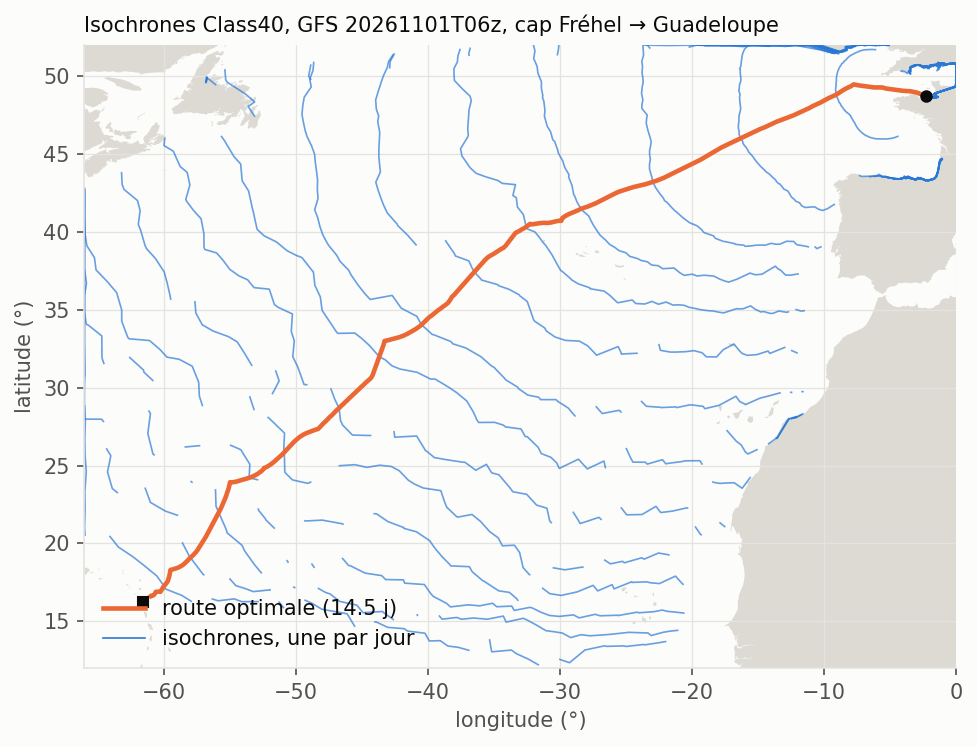
_Une isochrone par jour pour un Class40, avec le vent GFS du matin du départ. Les fronts avancent vite dans le flux de nord-est du golfe de Gascogne, puis s'étirent vers le sud-ouest dans les alizés. La route optimale, en orange, est remontée depuis l'arrivée._

### Le lien avec la programmation dynamique

Pourquoi a-t-on le droit de jeter tous les points à l'intérieur de l'enveloppe ? La réponse tient dans une idée de Richard Bellman, publiée dans les années 1950 sous le nom de **principe d'optimalité**. Une route optimale est faite de morceaux eux-mêmes optimaux. Si la meilleure route vers Pointe-à-Pitre passe par les Açores, alors sa première partie est forcément la meilleure route vers les Açores. Sinon on pourrait la remplacer par un chemin plus rapide et gagner du temps sur l'ensemble.

Notons $$ T^\star(p) $$ le temps minimal pour atteindre le point $$ p $$ depuis le départ. Le principe de Bellman s'écrit

$$ T^\star(q) = \min_{p \,\to\, q} \Big( T^\star(p) + \tau(p, q) \Big) $$

où $$ \tau(p,q) $$ est le temps pour aller de $$ p $$ à $$ q $$, et le minimum porte sur tous les points $$ p $$ d'où l'on peut rejoindre $$ q $$. En mots, le meilleur temps pour arriver en $$ q $$ est le meilleur temps pour arriver juste avant, plus le dernier petit trajet. On calcule donc les temps de proche en proche, ce qui évite d'énumérer toutes les routes possibles, dont le nombre explose avec la distance. C'est le cœur de la **programmation dynamique**.

Les isochrones sont exactement cette récurrence. L'isochrone au temps $$ t $$ est la frontière de l'ensemble des points tels que $$ T^\star(p) \le t $$. C'est une courbe de niveau de la fonction $$ T^\star $$, comme une ligne d'altitude sur une carte de randonnée. Un point à l'intérieur de l'enveloppe a été atteint plus tôt par un autre chemin, il est déjà couvert par la frontière, d'où l'élagage. La programmation dynamique classique découperait la mer en cases et calculerait $$ T^\star $$ pour chacune. Les isochrones font le même calcul en suivant uniquement la frontière, ce qui les rend beaucoup plus rapides.

D'autres approches existent, comme la recherche de plus court chemin sur un graphe (algorithmes de Dijkstra ou A*), la commande optimale continue issue du principe de Pontryagin, ou des méthodes heuristiques comme les algorithmes génétiques. Elles reposent presque toutes sur la même idée de fond.

### Le lien avec l'optimisation linéaire

Dans mon article sur [l'équipement optimal dans Dofus](/posts/PanoplieOptimale/), j'avais utilisé l'optimisation linéaire. Le routage s'y rattache plus qu'on pourrait le croire. Découpons la mer en un graphe de points reliés par des arcs, chaque arc $$ (i,j) $$ ayant un temps de parcours $$ c_{ij} $$. Trouver le plus court chemin revient à envoyer une unité de « bateau » du départ à l'arrivée en minimisant le temps total.

$$ \min \sum_{(i,j)} c_{ij}\, f_{ij} \quad \text{avec} \quad \sum_{j} f_{ij} - \sum_{j} f_{ji} = \begin{cases} 1 & \text{au départ} \\ -1 & \text{à l'arrivée} \\ 0 & \text{ailleurs} \end{cases}, \qquad f_{ij} \ge 0 $$

La variable $$ f_{ij} $$ vaut 1 si la route emprunte l'arc $$ (i,j) $$. La contrainte dit simplement que tout ce qui entre en un point en ressort, sauf au départ et à l'arrivée.

Tout programme linéaire a un jumeau appelé son **dual**. Ici le dual attribue à chaque point $$ i $$ une valeur $$ d_i $$ et cherche à écarter le plus possible le départ de l'arrivée, avec une seule règle.

$$ d_j - d_i \le c_{ij} \quad \text{pour chaque arc} $$

Une image classique aide à le comprendre. Imaginons un modèle en ficelles où chaque arc est une ficelle de longueur $$ c_{ij} $$. On tient le départ d'une main, l'arrivée de l'autre, et on tire. Les ficelles qui se tendent dessinent le plus court chemin, et la hauteur de chaque nœud $$ d_i $$ donne son temps d'accès depuis le départ. À l'optimum, chaque point du chemin vérifie $$ d_j = \min_i (d_i + c_{ij}) $$, ce qui est exactement l'équation de Bellman. Programmation dynamique et optimisation linéaire résolvent donc le même problème. La première exploite la structure séquentielle du trajet, d'où sa rapidité.

Cette dualité a une histoire qui nous servira plus loin. En octobre 1947, George Dantzig, qui venait d'inventer l'algorithme du simplexe, rend visite à John von Neumann à Princeton pour lui présenter l'optimisation linéaire. Von Neumann comprend tout de suite et lui expose la théorie de la dualité, qu'il relie à la théorie des jeux qu'il a développée vingt ans plus tôt.

## Combiner les isochrones et les scénarios météo

Revenons à l'incertitude. Avec un ensemble de 31 membres, je lance le calcul des isochrones 31 fois, une fois par scénario. J'obtiens 31 routes optimales $$ r_1, \dots, r_{31} $$. Quand on les superpose sur une carte, on obtient un plat de spaghettis. Certaines passent au nord, d'autres au sud, certaines se ressemblent beaucoup.

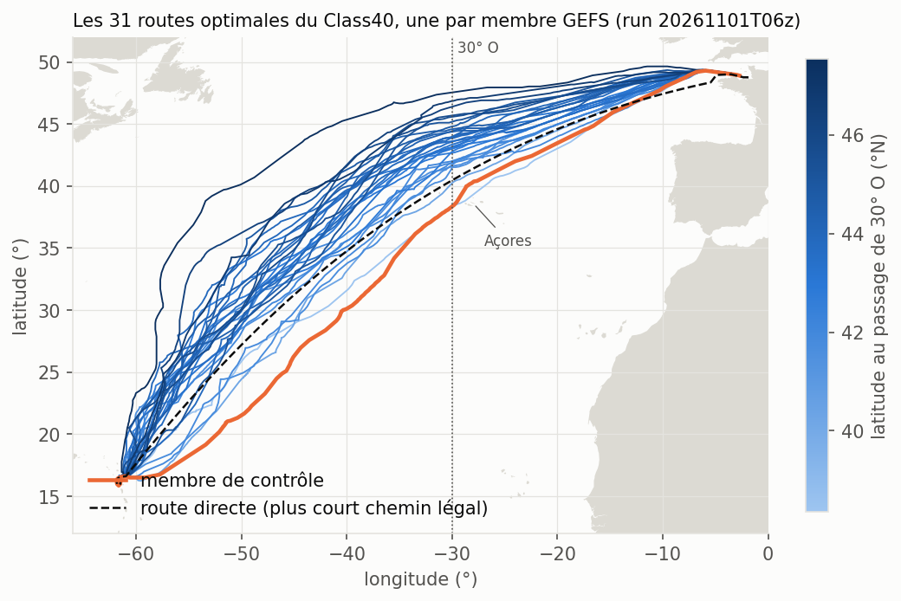
_Les 31 routes optimales du Class40 virtuel, une par membre GEFS, calculées le 1er novembre depuis sa position de 16 h UTC au large de Bréhat. Chaque route est colorée selon la latitude à laquelle elle franchit le méridien 30° O, du plus clair au sud au plus foncé au nord. Les routes restent groupées pendant deux jours et demi, puis s'ouvrent en éventail. Au passage de 30° O, elles s'étalent de 38° à 48° N, sans former deux groupes nets. En pointillé, la route directe, le plus court chemin légal de 3 577 milles. La plupart des routes passent au nord de la route directe et des Açores. Trois seulement, dont celle du membre de contrôle, longent les Açores par le sud, et aucune ne descend chercher les alizés au large des Canaries par la route sud classique. Selon le scénario, la traversée prend de 13,1 à 17,7 jours, et la latitude de passage ne dit pas grand-chose de la durée._

Chacune de ces routes est la meilleure dans son propre monde. Pour savoir ce qu'elle vaut ailleurs, je fais naviguer chaque route $$ r_i $$ dans chaque scénario $$ s_j $$. J'obtiens une matrice de temps de parcours $$ T_{ij} $$, le temps de la route $$ i $$ quand la météo est celle du scénario $$ j $$. Par construction, la meilleure valeur de chaque colonne se trouve sur la diagonale, puisque la route $$ r_j $$ a été calculée pour le scénario $$ j $$.

Il faut préciser ce que veut dire « faire naviguer une route dans un autre scénario ». On peut suivre la trace géographique, suivre la suite de caps, ou suivre la route en s'autorisant des corrections. Ce choix change la matrice.

Dans le projet, j'ai choisi une quatrième voie, qui ressemble davantage à ce que fait un marin. Je ne m'engage pas sur une route entière, seulement sur le prochain choix structurant. Un skipper ne décide pas au départ de chaque bord jusqu'à la Guadeloupe. Il décide d'abord de quel côté d'une dépression ou d'un anticyclone il va passer, et il verra la suite plus tard. Je représente ce choix par une **porte**.

Une porte est un point de passage, une latitude et une longitude, que le bateau s'impose d'atteindre à une échéance donnée. Il ne faut pas la confondre avec les portes imposées par un règlement de course, comme les portes des glaces du Vendée Globe. Ici, c'est le skipper qui se l'impose à lui-même. En pratique, les navigateurs font la même chose avec un waypoint forcé dans leur logiciel de routage. Ils le placent à la main, d'un côté puis de l'autre d'une dépression, et comparent les temps d'arrivée. Je place mes portes automatiquement, à partir du faisceau des routes d'ensemble. Je choisis d'abord l'échéance où ce faisceau commence à s'ouvrir, ici trois jours après le départ. À cette échéance, je relève la position de chacune des 31 routes, et je place cinq portes sur ces positions, du sud au nord. Je calcule les 10ᵉ, 30ᵉ, 50ᵉ, 70ᵉ et 90ᵉ centiles de leurs latitudes, et chaque porte est la position de la route la plus proche de l'un de ces centiles. Chaque porte est donc un point qu'au moins un scénario atteint vraiment à cette échéance. Les portes couvrent ainsi la largeur du faisceau, des options les plus au sud aux plus au nord. Choisir une porte revient donc à choisir une option, plus ou moins au nord, sans encore choisir la route complète. Pour chaque porte $$ g $$ et chaque scénario $$ m $$, le temps total est

$$ T_{gm} = \tau(\text{départ} \to g \mid m) + \tau(g \to \text{arrivée} \mid m) $$

La seconde partie est le **recours**. Une fois la porte passée, je suppose qu'on routera au mieux dans la météo qui se réalisera. L'hypothèse est optimiste, puisqu'elle suppose qu'on saura alors quel scénario est le bon, mais c'est le cadre classique de la programmation stochastique à deux étapes. La matrice compte 5 lignes et 31 colonnes, et la question devient le choix d'une ligne.

Reste la vraie question. Quelle ligne de la matrice choisir ?

## Le contrôle robuste

### Risque et incertitude

L'économiste Frank Knight distinguait en 1921 deux situations. Dans le **risque**, on connaît les probabilités des différents événements, comme au casino. Dans l'**incertitude**, on les ignore, ou on s'en méfie. Les membres d'un ensemble météo sont censés être équiprobables, et les prévisionnistes eux-mêmes doutent que chaque scénario ait exactement une chance sur 31 de se réaliser. On se trouve quelque part entre les deux, et c'est cette zone grise qui rend le choix intéressant.

### Le minimax de von Neumann

En 1928, le jeune John von Neumann publie à Göttingen un article sur la théorie des jeux de société. Il y étudie les jeux à deux joueurs où ce que l'un gagne, l'autre le perd. Pierre-feuille-ciseaux ou le tir au but au football en sont de bons exemples. Chaque joueur sait que l'autre cherche à lui nuire. La stratégie prudente consiste alors à choisir le coup qui donne le meilleur résultat dans le pire des cas, c'est-à-dire à minimiser sa perte maximale. D'où le nom de **minimax**.

Le théorème de von Neumann affirme que dans ces jeux, si les joueurs ont le droit de tirer leur coup au hasard, les deux points de vue se rejoignent. Le mieux que je puisse garantir en me protégeant du pire est égal au pire que mon adversaire puisse m'infliger en jouant au mieux. Il existe une valeur du jeu.

$$ \min_{x} \max_{y} \; x^\top A\, y \;=\; \max_{y} \min_{x} \; x^\top A\, y $$

Ici $$ A $$ est la table des gains, $$ x $$ et $$ y $$ sont les probabilités avec lesquelles chaque joueur choisit ses coups. Pour le tir au but, cela explique pourquoi un tireur a intérêt à varier ses côtés de façon imprévisible. C'est ce théorème que von Neumann reconnaîtra en 1947 dans la dualité de Dantzig. En 1944, il en fait avec l'économiste Oskar Morgenstern la base d'un livre, *Theory of Games and Economic Behavior*, qui fonde la théorie des jeux moderne.

Ce minimax a des racines viennoises. Morgenstern dirigeait à Vienne l'Institut autrichien de recherche sur la conjoncture et fréquentait le colloque mathématique de Karl Menger, lui-même membre du Cercle de Vienne, celui qui lisait ligne à ligne le [*Tractatus* de Wittgenstein](/posts/tractatus/). C'est par Menger que Morgenstern recrute un jeune mathématicien, Abraham Wald. Von Neumann croisait aussi ce monde. En 1930, à la conférence de Königsberg coorganisée par le Cercle de Vienne, il défendait le programme formaliste quand Kurt Gödel y a annoncé son théorème d'incomplétude, et il fut l'un des premiers à en saisir la portée.

Wittgenstein, Gödel, von Neumann, Morgenstern et Wald se sont donc croisés, de près ou de loin, autour des mêmes séminaires viennois. Le Cercle de Vienne cherchait à fonder la connaissance sur la logique et la vérification. De ce milieu sont sortis à la fois le théorème d'incomplétude, qui borne ce que la logique peut prouver, et la théorie des jeux, qui apprend à décider quand on ne peut pas tout savoir. Cette histoire mérite un article à elle seule, et je la développerai dans un futur article.

Wald, émigré aux États-Unis en 1938, transpose le minimax à la statistique. Il imagine un jeu entre le décideur et la Nature. La Nature choisit l'état du monde, le décideur choisit son action, et faute de connaître les intentions de la Nature, il se prémunit contre le pire. Pour notre routeur, la Nature choisit le scénario météo, et le skipper choisit sa route.

### Quatre règles de décision

Formalisons. On dispose d'actions $$ a $$ (les routes), de scénarios $$ s $$ (les membres de l'ensemble) et d'un coût $$ C(a,s) $$ (le temps de parcours). Plusieurs règles permettent de choisir.

- **Laplace** fait la moyenne sur les scénarios, en les supposant équiprobables, et choisit la route la plus rapide en moyenne.

$$ \min_a \frac{1}{|\mathcal{S}|} \sum_s C(a,s) $$

- **Wald** applique le minimax et choisit la route dont le pire temps est le plus court.

$$ \min_a \max_s C(a,s) $$

- **Hurwicz** mélange le meilleur et le pire cas avec un coefficient d'optimisme $$ \alpha $$ compris entre 0 et 1.

$$ \min_a \Big( \alpha \min_s C(a,s) + (1-\alpha) \max_s C(a,s) \Big) $$

- **Savage** introduit le **regret**, en 1951, en réponse à Wald.

Le regret mesure l'écart entre ce qu'on a fait et ce qu'on aurait fait si l'on avait connu le scénario à l'avance.

$$ R(a,s) = C(a,s) - \min_{a'} C(a',s) $$

La règle de Savage choisit l'action dont le plus grand regret est le plus petit.

$$ a^\star = \arg\min_a \max_s R(a,s) $$

La différence avec Wald est subtile et importante. Si une tempête ralentit toute la flotte, le retard vient de la météo, et le regret est nul pour qui a pris la meilleure route possible. Le regret compare chaque décision à la meilleure décision possible dans le même monde. Il isole donc la part du résultat qui dépend vraiment du choix. Wald, lui, se concentre sur le pire scénario dans l'absolu, et finit souvent par choisir une route médiocre partout.

Un petit exemple rend les choses concrètes. Prenons trois routes (nord, directe, sud) et quatre scénarios, avec des temps de parcours en heures.

| Route | $$ s_1 $$ | $$ s_2 $$ | $$ s_3 $$ | $$ s_4 $$ | Moyenne | Pire cas |
|---|---|---|---|---|---|---|
| Nord | 195 | 200 | 205 | 265 | **216,25** | 265 |
| Directe | 210 | 212 | 214 | 232 | 217 | 232 |
| Sud | 225 | 226 | 228 | 228 | 226,75 | **228** |

La route nord est la meilleure en moyenne et la route sud la meilleure dans le pire cas. Calculons maintenant les regrets en retranchant à chaque colonne son minimum.

| Route | $$ s_1 $$ | $$ s_2 $$ | $$ s_3 $$ | $$ s_4 $$ | Regret maximal |
|---|---|---|---|---|---|
| Nord | 0 | 0 | 0 | 37 | 37 |
| Directe | 15 | 12 | 9 | 4 | **15** |
| Sud | 30 | 26 | 23 | 0 | 30 |

La règle de Savage choisit la route directe. Elle perd dans chaque scénario, mais toujours de peu, au plus 15 heures. Trois règles, trois routes différentes. C'est ce que j'entends par **dérisquer** une décision. On accepte de perdre un peu en moyenne pour borner l'écart avec la bonne décision.

Le regret a une limite qu'il faut connaître. Ajouter une route candidate, même mauvaise, peut modifier le minimum d'une colonne et donc changer la décision. La liste des routes qu'on accepte de comparer fait partie de la décision elle-même.

### Retour à l'optimisation linéaire

Ces règles s'écrivent très bien comme des programmes linéaires, avec les mêmes outils que pour Dofus. Introduisons une variable binaire $$ b_i $$ qui vaut 1 si l'on choisit la route $$ i $$, et une variable $$ t $$ qui représente le pire regret. Notons $$ T^\star_j $$ le meilleur temps possible dans le scénario $$ j $$. Le regret minimax devient

$$ \min t \quad \text{avec} \quad \sum_i b_i\, T_{ij} - T^\star_j \le t \;\text{ pour chaque scénario } j, \qquad \sum_i b_i = 1 $$

Chaque scénario ajoute simplement une contrainte. Le maximum, difficile à manipuler, disparaît au profit d'une variable qui doit dominer tous les cas. C'est l'astuce de base de l'**optimisation robuste**, développée notamment par Ben-Tal, El Ghaoui et Nemirovski. On peut aussi remplacer le choix d'une route parmi 31 par des routes construites directement par l'optimiseur, et le problème reste du même type.

### Du choix d'une route au contrôle robuste

Tout ce qui précède choisit une route une fois pour toutes. Un marin, lui, ajuste sa trajectoire à chaque nouveau fichier météo. C'est ici qu'intervient le **contrôle robuste**. On reprend le système de l'article sur la pensée systémique, et on y ajoute une perturbation inconnue $$ w $$, ici le vent réel.

$$ \dot{x} = f(x, u, w), \qquad w \in \mathcal{W} $$

Le contrôle stochastique suppose connue la loi de $$ w $$ et minimise le coût moyen. Le contrôle robuste suppose seulement que $$ w $$ reste dans un ensemble $$ \mathcal{W} $$ et minimise le coût dans le pire cas, ou le regret. On retrouve le jeu de von Neumann, entre le contrôleur et une Nature adversaire. Les automaticiens ont développé cette idée à partir des années 1980 avec la commande $$ H_\infty $$, qui cherche à limiter l'effet de la pire perturbation possible sur l'erreur.

La pratique du skipper correspond à la **commande prédictive**, ou commande à horizon glissant. On optimise sur tout l'horizon de la prévision, on applique seulement le premier bord, puis on recommence à l'arrivée du fichier suivant, toutes les six heures pour GEFS. Cette façon de faire introduit la notion de **recours**. Une bonne décision robuste garde de bonnes options ouvertes pour la suite. Choisir tôt un côté d'une dorsale est irréversible, et ce coût de l'irréversibilité devrait entrer dans le calcul.

## Ce qu'a donné la Route du Rhum

### La décision du départ

Reprenons le jour du départ, le 1er novembre. Mon Class40 virtuel est parti à 13 h 02 avec la flotte, et à 16 h UTC il se trouve au large de Bréhat. Le routeur dispose du run GEFS de 6 h. Le choix se fait entre les cinq portes définies plus haut, cinq points de passage à atteindre trois jours plus tard, le 4 novembre à 16 h, notés P1 à P5 du sud au nord. Elles se trouvent à l'ouest de la Galice, entre 43,3° et 46,6° N, et la carte des positions réelles, plus bas, les montre. Voici ce que vaut chacune d'elles sur les 31 scénarios, en heures de course depuis la position de 16 h. La dernière colonne donne le temps dans le seul scénario du membre de contrôle, celui que regarderait un routeur qui ne connaît qu'une prévision.

| Porte | Position | Moyenne (Laplace) | Pire cas (Wald) | Hurwicz ($$ \alpha = 0{,}5 $$) | Regret maximal (Savage) | Scénario de contrôle |
|---|---|---|---|---|---|---|
| P1 | 43,3° N 23,0° O | 364,0 | 419,6 | 365,0 | 18,4 | **370,0** |
| P2 | 44,2° N 24,2° O | 363,0 | **411,8** | **361,2** | 24,5 | 392,8 |
| P3 | 45,0° N 23,3° O | **362,2** | 416,9 | 364,2 | 21,3 | 379,6 |
| P4 | 45,6° N 23,1° O | **362,2** | 413,4 | 362,9 | **16,2** | 381,0 |
| P5 | 46,6° N 23,1° O | 362,5 | 414,2 | 364,1 | 20,6 | 378,6 |

Cette fois, les règles ne s'accordent pas. Le scénario de contrôle désigne P1, la porte la plus au sud. Laplace hésite entre P3 et P4, à égalité à quelques secondes près. Wald et Hurwicz choisissent P2, et Savage choisit P4. On retrouve la situation du petit exemple présenté plus haut, avec trois routes (nord, directe et sud) et quatre scénarios, où chaque règle choisissait une route différente.

Les écarts sont pourtant faibles. Les moyennes tiennent en deux heures sur quinze jours de course, et les regrets maximaux vont de 16 à 25 heures. Le scénario de contrôle, lui, fait croire à des écarts bien plus grands, puisqu'il donne 23 heures d'avance à P1 sur P2. C'est le piège de la prévision unique. Elle exagère des différences qui disparaissent quand on regarde l'ensemble. La **valeur de l'information parfaite** confirme cet ordre de grandeur. Si l'on savait à l'avance quel scénario va se réaliser, on gagnerait en moyenne 3,1 heures sur le meilleur choix fait sans le savoir.

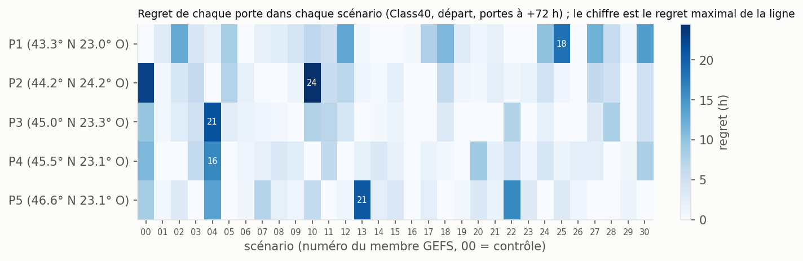
_Le regret de chaque porte dans chaque scénario. Chaque scénario porte le numéro du membre GEFS qui le produit, 00 étant le contrôle. La plupart des cases sont presque blanches, toutes les portes se valent dans la majorité des scénarios. La porte du contrôle, P1, perd plus de 10 heures dans six scénarios, et jusqu'à 18 heures dans le scénario 25. La porte de Savage, P4, ne perd plus de 10 heures que dans deux scénarios, et au plus 16 heures dans le scénario 04._

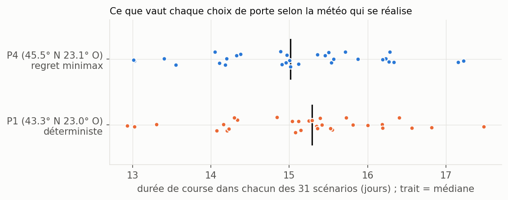
_La durée de course dans chacun des 31 scénarios, pour la porte du scénario de contrôle et pour la porte du regret minimax. Les deux nuages se ressemblent beaucoup. Le choix de la porte pèse peu face à l'écart entre les scénarios, qui va de 13 à 18 jours._

### Cycle après cycle

Le projet a refait cette analyse toutes les six heures pour le Class40 virtuel. Sur les 32 cycles où il restait plus de cinq jours de course, entre le 1er et le 9 novembre, la porte du scénario de contrôle n'a jamais été celle que choisissaient à la fois Laplace, Wald et Savage. Le regret minimax a choisi la même porte que la moyenne dans la moitié des cycles, et la même que le scénario de contrôle dans 7 cycles seulement. Le regret maximal médian de la porte du contrôle est de 19 heures, contre 12 heures pour la porte de Savage.

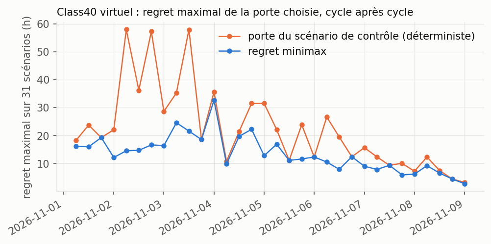
_Le regret maximal de la porte choisie, à chaque cycle, pour le scénario de contrôle et pour le regret minimax. Les deux courbes se rejoignent à mesure que l'arrivée approche et que les scénarios se ressemblent._

Il faut lire ce graphique avec prudence. La règle de Savage minimise par construction le regret maximal, et elle ne peut donc qu'être en dessous de l'autre courbe. Le graphique montre que la prévision unique s'expose parfois à des regrets de 50 à 60 heures, surtout dans les trois premiers jours, et que la décision robuste ramène ce risque autour de 15 heures. Il ne dit pas si la route robuste aurait été plus rapide dans la météo qui s'est réalisée. Ce test vient plus bas, une fois la course finie.

### Et les vrais skippers ?

Le 4 novembre à 16 h, à l'échéance des portes, les futurs premiers étaient groupés.

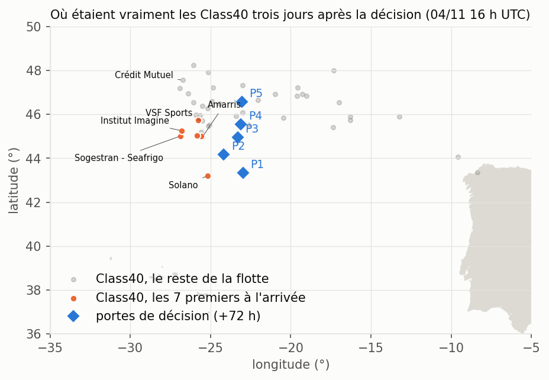
_Les positions des Class40 relevées sur la cartographie officielle le 4 novembre à 16 h UTC, et les cinq portes calculées le jour du départ. En orange, les sept premiers à l'arrivée, le reste de la flotte en gris._

Six des sept premiers à l'arrivée naviguaient ensemble vers 45° N, à la latitude des portes P3 et P4, mais deux à quatre degrés plus à l'ouest. Ils allaient plus vite que mes polaires ORC et avaient donc parcouru plus de chemin. Le dernier, Solano, quatrième à l'arrivée, avait choisi une ligne plus au sud, vers 43° N, à la latitude de P1. Plusieurs bateaux du milieu de flotte, comme Crédit Mutuel, étaient plus au nord, vers 47° N.

Le vrai choix stratégique est venu après, entre 25° et 35° O.

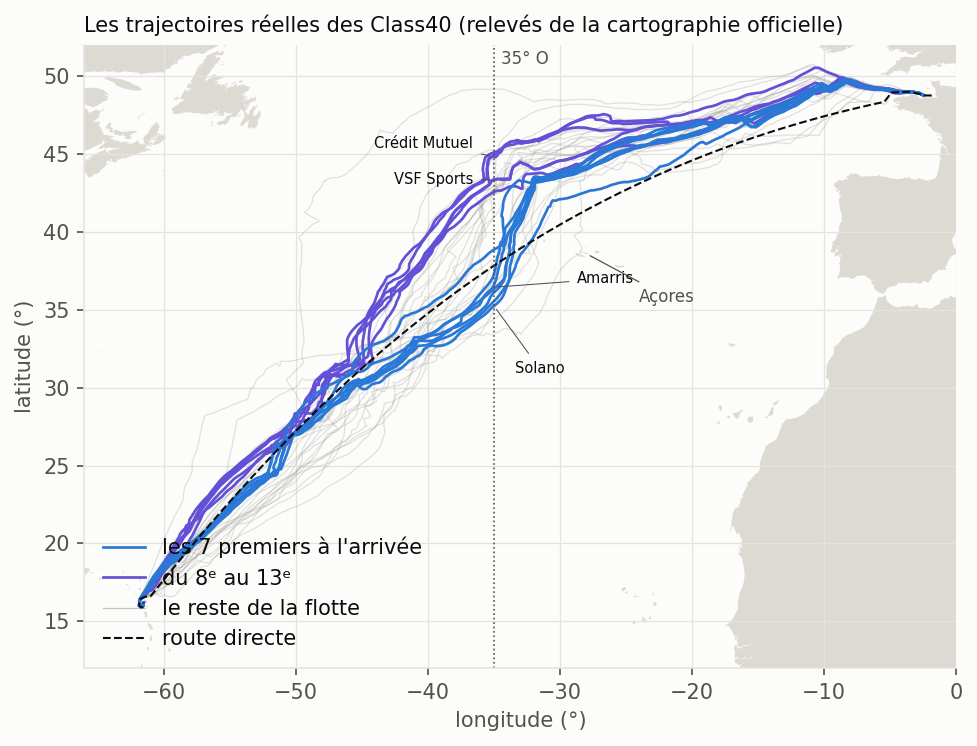
_Les trajectoires des Class40 reconstruites à partir des positions relevées toutes les demi-heures. En bleu, les sept premiers à l'arrivée, en violet les six suivants, le reste de la flotte en gris. En pointillé, la route directe._

Les sept premiers ont plongé vers le sud-ouest dès 33° O, en passant sous la route directe. Au passage de 35° O, ils étaient tous entre 35° et 39° N. Le groupe suivant, de VSF Sports, Maccaferri Futura, Patapain, Crédit Mutuel et deux autres, a continué vers l'ouest au nord, entre 42° et 45° N, avant de descendre beaucoup plus tard vers les alizés. Les sept premiers sont arrivés entre le 15 novembre en début d'après-midi et le 16 au matin, menés par Amarris et Sogestran - Seafrigo, à moins d'une demi-heure d'intervalle, après un peu plus de 14 jours de course. Le groupe du nord est arrivé le 17 novembre, avec près d'un jour et demi de retard sur la tête. Une même flotte, partie groupée, s'est donc séparée en deux options nettes. Cette fois, on voit un vrai groupe dans les données.

Pourquoi ce partage ? Ce n'est pas une question de bateau, car on retrouve les mêmes architectes des deux côtés. Solano et Maccaferri Futura sont deux plans Guelfi de 2025. Le premier est passé au sud et a fini quatrième, le second est passé au nord et a fini neuvième. Sogestran - Seafrigo et Inland Roots sont deux plans Manuard récents, deuxième au sud et douzième au nord. Une partie de l'écart vient tout de même des bateaux et des marins, puisque la tête avait déjà une soixantaine de milles d'avance le 5 novembre, avant la séparation. Mais l'essentiel s'est joué ensuite, et l'écart a atteint 235 milles le 11 novembre.

La raison est météorologique.

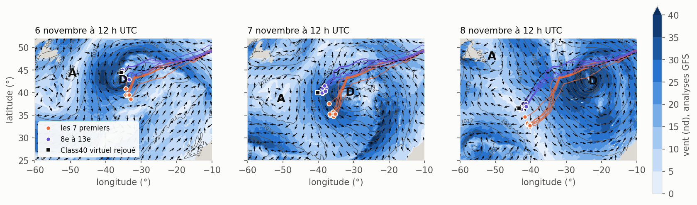
_Le vent analysé par GFS (couleur pour la force, flèches pour le sens) et les isobares, du 6 au 8 novembre. D marque le centre de la dépression, A celui de l'anticyclone. En orange, les sept premiers à l'arrivée, en violet les six suivants, avec leur trajectoire jusqu'à la date de chaque carte. Le carré noir est mon Class40 virtuel._

Le 6 novembre, une dépression d'environ 992 hPa se creuse sur la route, vers 43° N 34° O. Le groupe du nord arrive presque sur son centre, là où le vent faiblit et tourne. Les sept premiers sont déjà descendus sur son flanc ouest. Dans l'hémisphère nord, le vent tourne autour d'une dépression dans le sens inverse des aiguilles d'une montre, et il souffle donc du nord sur ce flanc. Les premiers y trouvent un vent fort et portant, environ 24 nœuds en moyenne entre le 5 et le 7 novembre, idéal pour plonger vers le sud-ouest. Le lendemain, ils naviguent vers 35° N dans un flux soutenu. Le groupe du nord reste vers 40° N, entre la dépression et l'anticyclone qui s'installe à l'ouest, dans un vent plus faible. Les premiers touchent ensuite les alizés plus tôt. L'option sud consistait donc à passer à l'ouest de la dépression pour profiter de son vent de nord, puis à rejoindre les alizés avant de buter sur l'anticyclone.

Mon routeur, lui, a choisi le nord. L'option sud figurait pourtant dans ses prévisions.

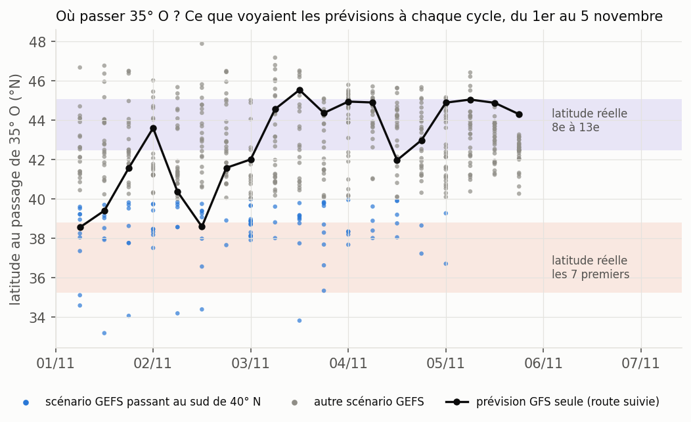
_À chaque cycle, du 1er au 5 novembre, la latitude à laquelle la route optimale franchit le méridien 35° O, dans chacun des 31 scénarios GEFS (points) et dans la prévision GFS seule (trait noir), celle que suivait mon Class40 virtuel. En bleu, les scénarios qui passent au sud de 40° N. Les bandes colorées donnent les latitudes réelles des deux groupes au même méridien. Les routes partent de la position du Class40 virtuel à chaque cycle._

Le 1er novembre, la prévision GFS seule proposait la route du sud, vers 38,5° N. Elle a ensuite hésité, puis elle est passée durablement au nord à partir du 3 novembre, entre 44° et 45,5° N, à la latitude du groupe du nord. Mon Class40 virtuel suivait cette prévision, et il est parti au nord avec ce groupe. L'ensemble a gardé l'option sud jusqu'au 4 novembre, mais en minorité, avec six scénarios sur 31 en moyenne, environ un sur cinq. Il ne disait pas que le sud était plus rapide. Il disait que le sud était la meilleure route dans un scénario sur cinq. Pour la saisir, il aurait fallu un routeur qui lise ce faisceau comme un signal, et non une prévision unique qui le laissait de côté. À partir du 5 novembre, il était trop tard, puisque plus aucun scénario ne passait au sud depuis la position de mon bateau.

C'est exactement le piège décrit au début de cet article. L'option gagnante dépendait d'une dépression à quatre ou cinq jours d'échéance, au-delà de ce qu'une prévision unique décrit de façon fiable. Elle n'était visible qu'à travers l'ensemble, comme une possibilité minoritaire, et c'est là que les marins de tête ont fait la différence.

### Confrontation avec le réel

Une fois la course finie, on peut rejouer les routes dans la météo qui s'est réellement produite, ce que personne ne pouvait faire pendant la course. J'ai reconstitué cette météo vécue en mettant bout à bout les analyses GFS, c'est-à-dire l'état initial de chaque run et sa prévision à 3 heures, soit un champ de vent toutes les trois heures du 1er au 20 novembre. Ce n'est pas le vent exact sur l'eau, que personne ne mesure partout, mais c'est la meilleure estimation disponible, et c'est la même référence pour toutes les routes comparées.

Dans cette météo, la route optimale de mon Class40 virtuel, de la ligne de départ à l'arrivée, prend 15,2 jours. Elle reste vers 43° N jusqu'à 30° O, puis plonge vers le sud-ouest. Elle passe à 42° N au méridien 35° O, entre les sept premiers et le groupe du nord, et à 37° N au méridien 40° O. Amarris a mis 14,1 jours, un jour de moins que cet optimum, parce que les vrais bateaux vont plus vite que ma polaire ORC. L'optimum a posteriori n'est donc pas un temps à battre pour les skippers. C'est une référence pour juger les décisions de mon propre routeur, avec la même polaire.

Pour chaque décision du Class40 virtuel, j'ai recalculé dans la météo vécue la route qui passe par chacune des cinq portes. On connaît alors la meilleure porte a posteriori, et le **regret réalisé** de chaque choix, c'est-à-dire le temps perdu par rapport à cette meilleure porte. Voici deux exemples, l'un défavorable au regret minimax, l'autre favorable.

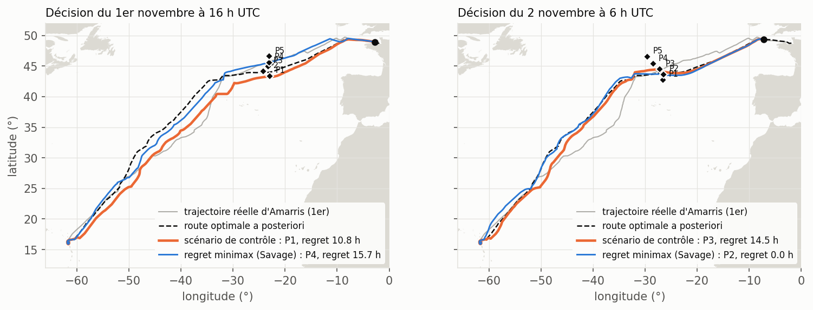
_Deux décisions du Class40 virtuel, rejouées dans la météo vécue. En pointillé noir, la route optimale a posteriori depuis la ligne de départ. En orange, la route qui passe par la porte du scénario de contrôle, en bleu celle qui passe par la porte du regret minimax, toutes deux calculées dans la météo vécue depuis la position du bateau au moment de la décision. En gris, la trajectoire réelle d'Amarris. La légende donne le regret réalisé de chaque choix._

Le premier exemple est la décision du départ, détaillée plus haut. Dans la météo vécue, la meilleure porte était P2, celle que choisissaient Wald et Hurwicz. La porte du contrôle, P1, perd 10,8 heures, et celle de Savage, P4, en perd 15,7. Le regret minimax se protégeait contre les pires scénarios de l'ensemble, mais la météo réelle n'en faisait pas partie, et la porte la plus au nord s'est révélée la plus lente. Ici, la prudence a coûté cher.

Le second exemple est la décision du 2 novembre à 6 h UTC, quand le bateau virtuel se trouvait au nord-ouest d'Ouessant. Le scénario de contrôle et la moyenne désignaient P3, Savage choisissait P2. Dans la météo vécue, P2 était la meilleure porte et P3 perdait 14,5 heures. Cette fois, le regret minimax a vu juste là où la prévision unique se trompait.

Deux exemples ne font pas une conclusion. Sur l'ensemble des 32 décisions, voici le regret réalisé de chaque règle, en heures.

| Règle | Regret médian | Regret moyen | Regret maximal | Meilleure porte trouvée |
|---|---|---|---|---|
| Scénario de contrôle seul | 3,9 | 4,5 | **15,1** | 3 fois sur 32 |
| Moyenne (Laplace) | 1,8 | **3,4** | 16,1 | **8 fois** |
| Pire cas (Wald) | **1,5** | 4,2 | 17,5 | **8 fois** |
| Hurwicz ($$ \alpha = 0{,}5 $$) | 1,7 | **3,4** | 17,5 | 5 fois |
| Regret maximal (Savage) | 2,5 | 4,0 | 17,0 | 7 fois |

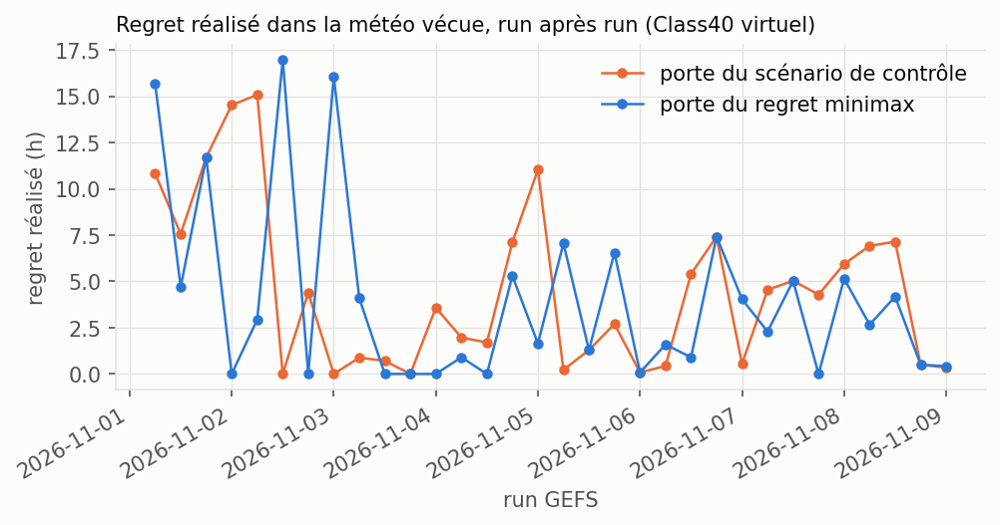
_Le regret réalisé, dans la météo vécue, de la porte du scénario de contrôle et de celle du regret minimax, pour chaque run GEFS où il restait plus de cinq jours de course. Les grands écarts sont concentrés dans les trois premiers jours, quand les portes sont encore loin de la météo connue._

Trois leçons s'en dégagent. D'abord, utiliser l'ensemble compte plus que le choix de la règle. Les quatre règles qui regardent les 31 scénarios font mieux que le scénario de contrôle seul, en médiane comme en moyenne. Le contrôle n'a trouvé la meilleure porte que 3 fois sur 32, moins souvent qu'un tirage au hasard, qui la trouverait environ une fois sur cinq. Ensuite, le regret minimax ne gagne pas à tous les coups. Il bat le contrôle dans 16 décisions, fait jeu égal dans 7 et perd dans 9. Il ne fait pas mieux que la simple moyenne, et son pire regret réalisé, 17 heures, n'est pas meilleur que celui du contrôle. C'est logique, puisque Savage ne garantit un regret borné qu'à l'intérieur des scénarios de l'ensemble, et la météo réelle n'est jamais exactement l'un d'eux. Enfin, les enjeux restent modestes. Un regret moyen de 3 à 5 heures sur quinze jours de course, c'est l'ordre de grandeur de la valeur de l'information parfaite calculée au départ, 3,1 heures.

Le même exercice permet de rejouer toute la course. Toutes les six heures, le Class40 virtuel recalcule sa route avec le seul run GFS disponible, puis la suit pendant six heures dans la météo vécue. Je l'ai comparé à la route du départ suivie sans jamais être remise à jour, avec les mêmes règles de navigation. Recalculer la route à chaque cycle fait gagner un jour entier, et le bateau termine à une heure et demie de l'optimum a posteriori. Une prévision déterministe mise à jour souvent reste donc proche de la meilleure route, du moins dans la météo vécue telle que le modèle la reconstruit.

Il faut garder les limites en tête. Les 32 décisions sont très corrélées entre elles, et une seule course ne fait pas une statistique. Le routeur lui-même n'est pas exact, et des écarts de moins d'une heure entre deux routes relèvent du bruit de calcul. Et la météo vécue reste une reconstruction par le modèle GFS. Le bilan est donc encourageant pour l'approche par ensemble, plus nuancé pour le regret minimax en particulier, qui reste avant tout une assurance contre les scénarios extrêmes que cette course n'a pas produits.

## Conclusion

Partir d'une question de voile m'a fait traverser plusieurs domaines qui se répondent. Les isochrones sont de la programmation dynamique, la programmation dynamique est le dual d'un programme linéaire, et la dualité linéaire est le théorème du minimax de von Neumann. Le contrôle robuste reprend ce minimax pour décider face à une Nature dont on ignore les intentions. Le regret de Savage en donne une version plus fine, qui compare chaque décision à ce qu'on aurait pu faire de mieux. Dérisquer, c'est accepter un peu moins de performance moyenne pour rester toujours proche de la bonne décision. L'idée dépasse largement la voile, elle vaut pour un investissement ou un choix technologique, partout où l'on dispose de scénarios sans probabilités crédibles.

## Références

- James, R. W. (1957). *Application of Wave Forecasts to Marine Navigation*. U.S. Navy Hydrographic Office.
- Zermelo, E. (1931). « Über das Navigationsproblem bei ruhender oder veränderlicher Windverteilung ». *Zeitschrift für Angewandte Mathematik und Mechanik*, 11(2), 114-124.
- Hagiwara, H. (1989). *Weather Routing of (Sail-Assisted) Motor Vessels*. Thèse, Delft.
- Bellman, R. (1957). *Dynamic Programming*. Princeton University Press.
- Lorenz, E. N. (1963). « Deterministic Nonperiodic Flow ». *Journal of the Atmospheric Sciences*, 20(2), 130-141.
- von Neumann, J. (1928). « Zur Theorie der Gesellschaftsspiele ». *Mathematische Annalen*, 100, 295-320.
- von Neumann, J., Morgenstern, O. (1944). *Theory of Games and Economic Behavior*. Princeton University Press.
- Dantzig, G. B. (1982). « Reminiscences about the origins of linear programming ». *Operations Research Letters*, 1(2), 43-48.
- Knight, F. H. (1921). *Risk, Uncertainty and Profit*. Houghton Mifflin.
- Wald, A. (1950). *Statistical Decision Functions*. Wiley.
- Savage, L. J. (1951). « The Theory of Statistical Decision ». *Journal of the American Statistical Association*, 46(253), 55-67.
- Ben-Tal, A., El Ghaoui, L., Nemirovski, A. (2009). *Robust Optimization*. Princeton University Press.
- Zhou, K., Doyle, J. C., Glover, K. (1996). *Robust and Optimal Control*. Prentice Hall.
- NOAA, Global Ensemble Forecast System (GEFS). ECMWF, Ensemble Prediction System (ENS).
